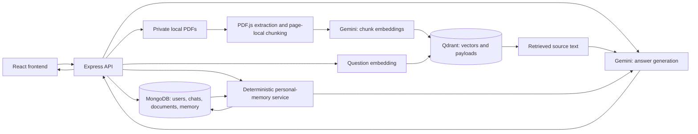
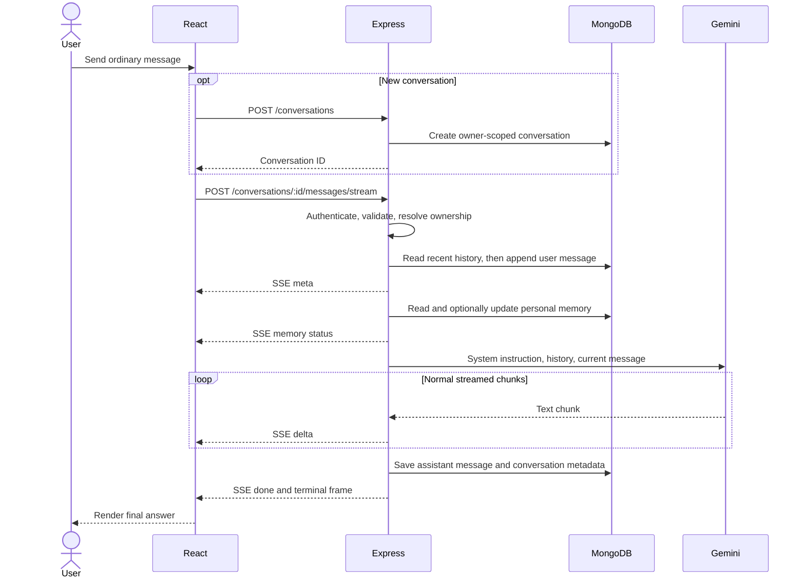
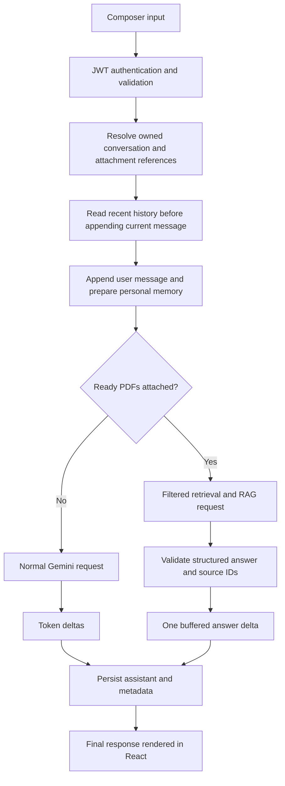
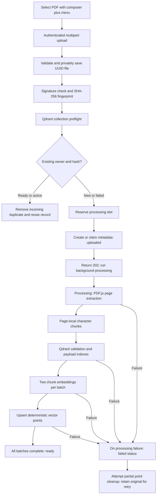
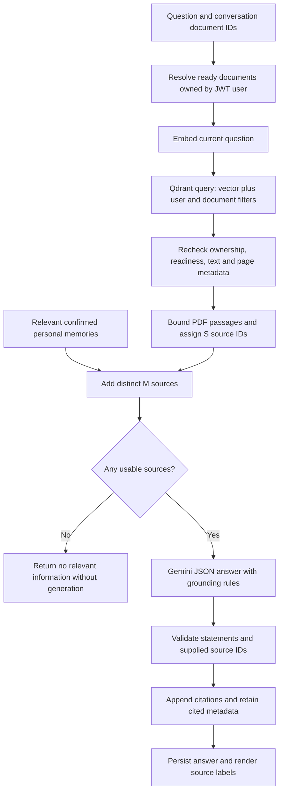
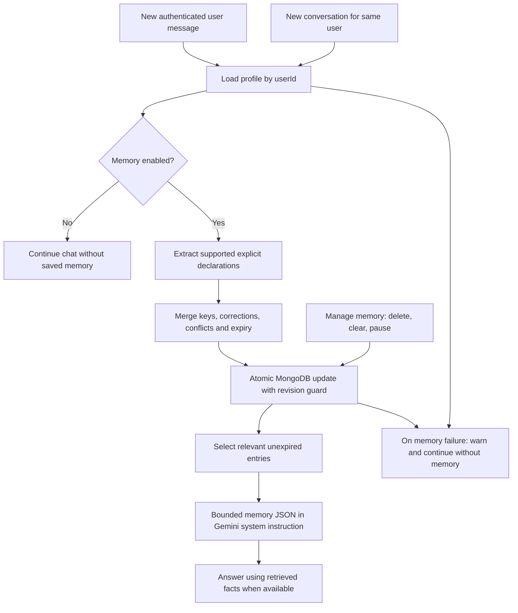
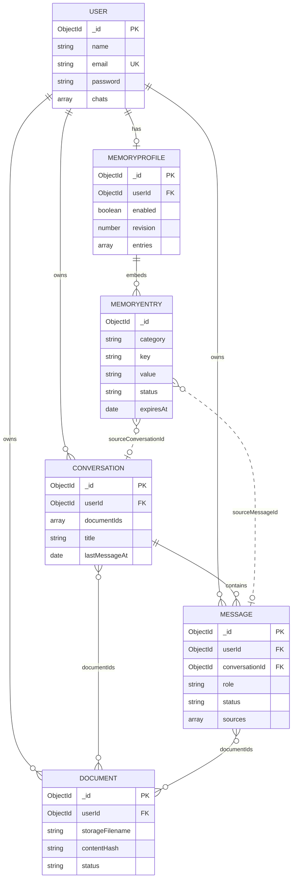

# AI-Buddy

AI-Buddy is a MERN chatbot built by Ayush Khandelwal with Google's Gemini API. It combines multiple saved conversations, streamed text responses, PDF question answering with source references, and structured personal memory across conversations belonging to the same authenticated user.

A basic chatbot sees the messages supplied in its current request. AI-Buddy additionally loads recent conversation history from MongoDB, selects relevant saved user facts, and, when PDFs are attached, retrieves document passages from Qdrant before asking Gemini for an answer. These are separate sources of context, with different ownership, persistence, and deletion rules.

Repository: [ayushkhandelwal18/AI-Chat-Bot](https://github.com/ayushkhandelwal18/AI-Chat-Bot). Additional implementation notes: [PDF RAG](backend/RAG.md) and [persistent memory](backend/MEMORY.md).

> This README describes the checked-in implementation, not a guarantee of deployed service availability or answer accuracy. Review [security limitations](#security-and-data-isolation) before exposing the server publicly, particularly the existing unauthenticated user-list endpoint.

## Table of contents

- [System overview](#system-overview)
- [Features](#features)
- [Technology and project structure](#technology-and-project-structure)
- [Setup and environment variables](#setup-and-environment-variables)
- [Gemini integration](#gemini-integration)
- [Normal chat, history, and context](#normal-chat-history-and-context)
- [PDF ingestion](#pdf-ingestion)
- [Embeddings and Qdrant](#embeddings-and-qdrant)
- [RAG retrieval and answer generation](#rag-retrieval-and-answer-generation)
- [Persistent memory](#persistent-memory)
- [History vs memory vs PDF RAG](#history-vs-memory-vs-pdf-rag)
- [Database design](#database-design)
- [API reference](#api-reference)
- [Frontend architecture](#frontend-architecture)
- [Security and data isolation](#security-and-data-isolation)
- [Errors and known limitations](#errors-and-known-limitations)
- [Testing and verification](#testing-and-verification)
- [Performance and API cost](#performance-and-api-cost)
- [Example workflows](#example-workflows)
- [Customization and contribution](#customization-and-contribution)
- [Glossary](#glossary)

## System overview

The React client talks to one Express API. MongoDB holds accounts, conversations, messages, document metadata, and personal memory profiles. Original PDFs remain in private backend storage. Gemini generates chat answers and embeddings through separate SDK clients and API keys. Qdrant holds document chunk vectors plus the text and metadata required to identify their sources.



The Express server waits for MongoDB connectivity before listening. Qdrant and embedding clients are lazy: importing the application does not initialize a collection, reprocess PDFs, or generate embeddings. Collection setup is an explicit operator command.

## Features

### Chat and conversations

- Multiple conversations per account, addressed by `/chat/:conversationId`.
- Sidebar with date grouping, client-side search over loaded titles/previews, inline rename, individual deletion, and delete-all.
- Conversations and messages stored separately in MongoDB, with pagination.
- Recent-message context for follow-up questions; only the selected recent history is sent to Gemini.
- Normal token streaming, Stop, persisted partial responses, copy answer, regenerate, and delete-message actions.
- Local conversation titles by default; optional Gemini titles.
- Markdown, GFM tables/lists, syntax-highlighted code, and copy-code controls.
- Responsive dark Material UI interface with a collapsible desktop sidebar and mobile overlay.

### PDF question answering

- Composer `+ → Upload PDF` picker; no separate RAG checkbox is required.
- Automatic upload, processing indicators, explicit retry, and submission blocked until every attached document is confirmed ready.
- Private PDF storage, authenticated metadata/status/list/delete APIs, extraction, chunking, embeddings, and Qdrant indexing.
- Byte-content duplicate detection per user, with reuse of ready documents.
- Selected attachments take priority; follow-up questions inherit the conversation's attachment set.
- Answers cite backend-validated source IDs, filenames, page ranges, and chunk references.
- `+ → Manage PDFs` lists documents and supports deletion. There is no PDF viewer or public download route.

### Persistent user memory

- Explicit personal details, education, skills/projects, supported communication preferences, and learning/goals saved as structured facts.
- Retrieval across conversations of the same authenticated user, including new chats without PDFs.
- Deterministic extraction and ranking: no extra model call for memory.
- Deduplication, explicit corrections, unresolved conflicts, bounded capacity, and expiry for temporary learning/goals.
- Chat-header **Manage memory** dialog to view, refresh, pause, delete individual entries, or clear all.
- Safe warnings when memory is unavailable; normal generation can continue.

## Technology and project structure

| Layer | Implementation |
|---|---|
| Frontend | React 19, JavaScript/JSX, Vite 7 with SWC, React Router 7 |
| UI | Material UI 7, Emotion, React Icons, React Hot Toast |
| Rendering | react-markdown, remark-gfm, react-syntax-highlighter |
| Transport | Axios for REST/upload progress; Fetch + ReadableStream for POST SSE |
| Backend | Node.js, Express 5, ES modules, express-validator |
| Authentication | bcrypt, jsonwebtoken, signed HTTP-only cookies via cookie-parser |
| Primary database | MongoDB through Mongoose 8 |
| Generation SDK | `@google/generative-ai`, locked at 0.24.1 |
| Embedding SDK | `@google/genai`, locked at 2.31.0 |
| Vector database client | `@qdrant/js-client-rest`, locked at 1.20.0 |
| PDF processing | `pdfjs-dist` legacy ESM build in a Node worker thread |

MongoDB can be local or hosted; the example URI uses Atlas. Qdrant accepts HTTP(S) REST endpoints and is intended to connect to the configured cluster. The installed `openai` dependency has no active call site in the inspected application services; this implementation uses Gemini.

```text
AI-Chat-Bot/
├── Readme.md
├── backend/
│   ├── .env.example
│   ├── package.json
│   ├── MEMORY.md
│   ├── RAG.md
│   ├── scripts/
│   │   ├── check-memory.mjs
│   │   ├── check-qdrant.js
│   │   ├── e2e-test.mjs
│   │   └── migrate-chats.js
│   └── src/
│       ├── index.js
│       ├── app.js
│       ├── db/connection.js
│       ├── config/
│       │   ├── geminiconfig.js
│       │   ├── rag.config.js
│       │   ├── qdrant.config.js
│       │   └── upload.config.js
│       ├── controllers/
│       │   ├── user.controller.js
│       │   ├── chat-controller.js
│       │   ├── conversation.controller.js
│       │   ├── document.controller.js
│       │   └── memory.controller.js
│       ├── routes/
│       │   ├── index.route.js
│       │   ├── user.route.js
│       │   ├── chat.route.js
│       │   ├── conversation.route.js
│       │   ├── document.route.js
│       │   └── memory.route.js
│       ├── middleware/
│       │   ├── error.middleware.js
│       │   └── pdf-upload.middleware.js
│       ├── models/
│       │   ├── user.model.js
│       │   ├── conversation.model.js
│       │   ├── message.model.js
│       │   ├── document.model.js
│       │   └── memory.model.js
│       ├── services/
│       │   ├── conversation.service.js
│       │   ├── gemini.service.js
│       │   ├── pdf.service.js
│       │   ├── pdf-extraction.worker.js
│       │   ├── chunking.service.js
│       │   ├── embedding.service.js
│       │   ├── document-processing.service.js
│       │   ├── document-index.service.js
│       │   ├── qdrant.service.js
│       │   ├── retrieval.service.js
│       │   ├── rag.service.js
│       │   ├── memory-extraction.service.js
│       │   ├── memory-policy.service.js
│       │   └── memory.service.js
│       └── utils/
│           ├── token-manager.js
│           ├── validators.js
│           ├── api-error.js
│           ├── service-error.js
│           └── constant.js
└── frontend/
    ├── .env.example
    ├── package.json
    ├── vite.config.js
    ├── public/
    └── src/
        ├── App.jsx
        ├── main.jsx
        ├── theme.js
        ├── index.css
        ├── Pages/
        │   ├── Home.jsx
        │   ├── Login.jsx
        │   ├── Signup.jsx
        │   ├── Chat.jsx
        │   └── Notfound.jsx
        ├── context/
        │   ├── AuthContent.jsx
        │   ├── ChatContext.jsx
        │   └── usePdfAttachments.js
        ├── helpers/
        │   ├── api.js
        │   └── document-attachments.js
        └── components/
            ├── Header.jsx
            ├── shared/
            └── chat/
                ├── Sidebar.jsx
                ├── ConversationItem.jsx
                ├── TopBar.jsx
                ├── MessageList.jsx
                ├── MessageBubble.jsx
                ├── MarkdownContent.jsx
                ├── CodeBlock.jsx
                ├── Composer.jsx
                ├── DocumentAttachments.jsx
                ├── DocumentManager.jsx
                └── MemoryDialog.jsx
```

The omitted generated/runtime directories include `node_modules`, `frontend/dist`, and `backend/uploads/pdfs`. Upload storage is created on demand. Backend responsibilities follow routes → controllers → services → models; authentication lives in `backend/src/utils/token-manager.js`. Frontend chat state is centralized in `ChatContext.jsx`, with attachment state delegated to `usePdfAttachments.js`.

## Setup and environment variables

### Prerequisites

- Git, npm, and a compatible Node.js runtime.
- MongoDB URI with read/write access and permission to build the schema indexes.
- A Gemini generation API key. PDF ingestion/retrieval additionally requires a separate embedding key and Qdrant configuration.
- A writable backend filesystem for PDFs.

Neither application package declares a top-level `engines` field. The installed PDF.js 6.4.299 declares Node `>=22.13.0 || >=24`; installed Vite 7.1.3 declares `^20.19.0 || >=22.12.0`. Use Node 22.13+ or a compatible newer release for the combined application. The backend also lists the npm `node` package as `^22.17.0`; this does not replace checking the actual runtime used to launch the server.

### Install and configure

```sh
git clone https://github.com/ayushkhandelwal18/AI-Chat-Bot.git
cd AI-Chat-Bot

cd backend
npm install
cp .env.example .env

cd ../frontend
npm install
cp .env.example .env
```

On PowerShell, use `Copy-Item .env.example .env` instead of `cp` if preferred. Fill in your own environment files before starting services. Avoid overwriting an existing configured `.env`. Both application directories have their own package manifest and lockfile; there is no root start script.

The backend's `rag.config.js` loads `backend/.env` using a module-relative absolute path. Existing deployment environment values take precedence. This loader is imported by the application and Gemini configuration, not just by RAG. Frontend Vite loads `frontend/.env`; `VITE_*` values are public browser configuration.

### Backend variables

Examples below are placeholders, not credentials.

| Variable | Used by | Required | Purpose / default | Example |
|---|---|---|---|---|
| `PORT` | API entry point | No | Listening port; default `3000` | `3000` |
| `MONGO_URL` | Mongoose connection/migration | Yes | MongoDB connection string | `mongodb://127.0.0.1:27017/ai_buddy` |
| `JWT_SECRET` | Token signing/verification | Yes for auth | Long independent signing secret | `<jwt-signing-secret>` |
| `COOKIE_SECRET` | Signed cookie parsing/issuance | Yes for auth | Separate cookie-signing secret | `<cookie-signing-secret>` |
| `FRONTEND_URL` | Express CORS | Yes for browser setup | Allowed frontend origin | `http://localhost:5173` |
| `GEMINI_API_KEY` | Chat and optional AI titles | Yes for generation | Existing generation key | `<generation-api-key>` |
| `GEMINI_HISTORY_MESSAGES` | Chat history query | No | Recent message count; default `20` | `20` |
| `CHAT_TITLE_MODE` | Conversation titles | No | `local` default; use `ai` for model-generated titles | `local` |
| `Gemini_API_KEY_for_embedding` | Embedding service | PDF RAG only | Separate, case-sensitive embedding key | `<embedding-api-key>` |
| `QDRANT_URL` | Qdrant REST client | PDF RAG only | Cluster REST endpoint, not dashboard | `https://<cluster-rest-host>:6333` |
| `QDRANT_API_KEY` | Qdrant REST client | PDF RAG only | Credential authorized for required collection operations | `<qdrant-api-key>` |
| `QDRANT_COLLECTION` | Qdrant services | PDF RAG only | Explicit collection name; no fallback | `ai_buddy_documents` |
| `PDF_MAX_SIZE_MB` | Multer upload configuration | No | Positive number; default `20`, multiplied by `1024 × 1024` bytes | `20` |
| `RAG_TOP_K` | Retrieval service | No | Integer `1–10`; default `5` | `5` |
| `NODE_ENV` | Authentication cookie flags | Deployment dependent | `production` enables Secure cookies and SameSite=None | `production` |
| `TEST_BASE` | API test script only | No | Default `http://localhost:3000/api/v1` | `http://localhost:3000/api/v1` |

`NODE_ENV` and `TEST_BASE` are referenced in code but are not entries in `backend/.env.example`. Memory adds no environment variables. `GEMINI_HISTORY_MESSAGES` is converted with `Number(...) || 20` without a range validator; configure a reasonable positive integer. The title implementation checks specifically for `local`; other values take the AI branch, so use the documented values intentionally.

### Frontend variables

| Variable | Used by | Required | Purpose | Example |
|---|---|---|---|---|
| `VITE_API_URL` | Axios base URL and SSE Fetch helper | Yes | Backend URL including `/api/v1` | `http://localhost:3000/api/v1` |

Do not put Gemini, MongoDB, Qdrant, JWT, or cookie secrets into frontend variables.

### MongoDB and indexes

The API connects using `MONGO_URL` and listens only after that connection succeeds. No MongoDB server/container is provisioned by a package script. Start your own server or configure a hosted database and network access.

Mongoose's installed default enables automatic index creation; application code does not override `autoIndex`. The upload path additionally awaits `Document.init()` before duplicate lookup. Index declarations include unique user email, unique memory owner, and a partial unique document `(userId, contentHash)` index. If deployment settings disable automatic index creation, explicitly provision and inspect the declared indexes before relying on deduplication or concurrent memory-profile creation. `Document.init()` is not a substitute for managing disabled auto-indexing.

### Qdrant setup

Set the cluster REST URL/key and a collection name. Dashboard hosts such as `cloud.qdrant.io` are rejected. The client validates HTTP(S), rejects embedded credentials/query strings/fragments, preserves explicit ports and path prefixes, and uses standard HTTP(S) ports when none is specified. Use HTTPS for a remote deployment.

From `backend`:

```sh
npm run qdrant:check
npm run qdrant:init
```

The first command inspects connectivity and collection configuration without writing. A missing collection is reported rather than created. The second creates only a missing collection with a single unnamed 768-dimensional vector using `Cosine` distance, then inspects it. Existing collections are never deleted/reset/recreated; incompatible dimensions, distance, named-vector configuration, or multivector configuration produce an error. Neither command invokes Gemini.

Ingestion separately ensures keyword payload indexes on `userId` and `documentId`; an existing incompatible payload index is rejected. The cluster credential therefore needs permissions for collection inspection, vector operations, and these payload indexes, plus collection creation if you use initialization.

### Start development servers

Backend terminal:

```sh
cd backend
npm run dev
```

Frontend terminal:

```sh
cd frontend
npm run dev
```

`npm start` in `backend` runs the server without nodemon. The default API base is `http://localhost:3000/api/v1`. Vite has no custom port/proxy configuration in `vite.config.js`; its usual development URL is `http://localhost:5173`, with the actual URL printed by Vite. If its port changes, update `FRONTEND_URL` accordingly.

Production frontend output is produced by `npm run build` in `frontend`. `npm run preview` previews that build; the Express app does not serve the frontend bundle. Configure hosting and SPA fallback for `/chat/:conversationId` separately. Persistent PDF storage is also a deployment responsibility.

### Available scripts and legacy migration

| Directory | Command | Effect |
|---|---|---|
| `backend` | `npm start` | Run `src/index.js` |
| `backend` | `npm run dev` | Run the API with nodemon |
| `backend` | `npm run qdrant:check` | Read Qdrant connectivity/collection configuration |
| `backend` | `npm run qdrant:init` | Initialize a missing compatible collection |
| `backend` | `npm run migrate -- --dry-run` | Inspect legacy embedded chats without data writes |
| `backend` | `npm run migrate` | Move eligible `User.chats` records into conversation/message collections |
| `backend` | `node --test scripts/check-memory.mjs` | Focused offline memory checks; not a package script |
| `backend` | `npm run test:api` | Live API tests; creates users and can spend Gemini quota |
| `frontend` | `npm run dev` | Vite development server |
| `frontend` | `npm run build` | Production frontend build |
| `frontend` | `npm run preview` | Preview the built frontend |
| `frontend` | `npm run lint` | Frontend ESLint |

Migration is optional for old embedded `User.chats` data, not required for a new installation. Back up the database, preview, then migrate. The script preserves array order, `legacyId`, and timestamps derived from embedded message ObjectIds where available. It creates an `isLegacy` conversation, inserts messages, and clears the old array only after insertion. It skips users with any existing legacy conversation or no embedded chats.

**Migration limitation:** these writes are not transactional. A partially failed run can leave an existing legacy conversation that causes the next run to skip that user. Inspect/repair partial results before rerunning; the implementation does not establish crash-safe or lossless recovery.

## Gemini integration

### Models, SDK methods, and responsibilities

| Operation | Model / implementation | API or SDK method | Input | Output / purpose |
|---|---|---|---|---|
| Normal complete answer | `gemini-2.5-flash` | `@google/generative-ai`: `startChat().sendMessage()` | System rules, selected history, relevant memory, current message | Complete conversational answer |
| Normal streamed answer | `gemini-2.5-flash` | `startChat().sendMessageStream()` | Same context types | Incremental text chunks |
| PDF-grounded answer | `gemini-2.5-flash` | `sendMessage()` with `responseMimeType: "application/json"` | Bounded history, memory rules, JSON question/source text | Structured statements for citation validation |
| Optional conversation title | `gemini-2.5-flash` | `model.generateContent()` | First user message and title instructions | Short title, with local fallback |
| Ingestion embeddings | `gemini-embedding-001` | `@google/genai`: `client.models.embedContent()` | Trimmed chunk texts, two per processing batch | 768-dimensional normalized vectors |
| Query embedding | `gemini-embedding-001` | Same embedding service, one input | Current question | Search vector |
| Personal-memory extraction/ranking | Deterministic JavaScript | Regex extraction, merge policy, local ranker | Newly submitted user text / relevant saved facts | MongoDB entries / selected context; no Gemini call |
| Default title | Deterministic JavaScript | `fallbackTitle()` | First user message | Local title; no Gemini call |

The generation model produces words. The embedding model produces numerical representations for matching text meaning; an embedding is not a generated answer.

All provider calls occur in backend services. `geminiconfig.js` creates the generation SDK client with `GEMINI_API_KEY`. `embedding.service.js` lazily creates its separate client with `Gemini_API_KEY_for_embedding`. The application does not configure Vertex AI.

Application code calls SDK methods rather than constructing HTTP endpoints. Inspection of the installed SDK implementations shows generation requests use `POST https://generativelanguage.googleapis.com/v1beta/models/gemini-2.5-flash:generateContent` or `:streamGenerateContent?alt=sse`. The installed `@google/genai` API-key embedding path maps `models.embedContent()` to `POST https://generativelanguage.googleapis.com/v1beta/models/gemini-embedding-001:batchEmbedContents`, including the one-query input case. These are SDK defaults, not additional application routes.

### Request construction

1. `getRecentMessages()` reads the most recent messages before the current user message is appended.
2. `toGeminiHistory()` retains user/assistant messages except `status: "failed"`, maps assistant to Gemini's `model` role, and creates `parts: [{ text: content }]`.
3. `buildModel()` combines the base persona/instructions, `memoryPrompt(memoryContext)`, and any custom RAG instruction into `systemInstruction`.
4. `model.startChat({ history })` receives the converted history. The new user turn is supplied separately to `sendMessage` or `sendMessageStream`, preventing duplicate inclusion of that turn.
5. For normal chat, that new turn is the message string. For RAG, it is JSON containing `question` and selected `sources` with `sourceId`, `sourceType`, and `text`.
6. Relevant personal facts are supplied as JSON data inside the system instruction. They are not an additional synthetic conversation or a vector search.
7. Complete replies use `result.response.text()`; normal streaming yields each SDK chunk's `text()`. The frontend receives these through the existing message/SSE API.

The base generation settings are `temperature: 0.6` and `maxOutputTokens: 2048`. Optional AI titles use `temperature: 0.3` and `maxOutputTokens: 256`, request at most six words, and clean/cap the returned title at 80 characters. Local title generation is the default and caps its derived title at about 60 characters.

Complete calls with a signal or custom instruction specify a 60,000 ms SDK timeout; RAG uses this path. Normal streaming supplies an AbortSignal and does not explicitly set that same timeout. Embeddings have their own 60,000 ms timeout and `retryOptions: { attempts: 1 }`. Application chat controllers do not automatically retry failed generation calls. Quotas/pricing are provider/account dependent; the repository does not enforce or verify a particular daily allowance.

## Normal chat, history, and context

### What each context component means

| Component | Meaning | Included when |
|---|---|---|
| System instructions | AI-Buddy behavior/persona, memory-use rules, and optional document-grounding rules | Base/memory rules on normal and RAG generation; extra RAG rules only for document answers |
| Conversation history | Previously stored messages from this conversation | Recent selection only; a new conversation starts empty |
| Context window | All input actually supplied for this particular generation | Current message plus the applicable components, not the entire MongoDB database |
| Persistent memory | Relevant structured personal facts/preferences owned by the user | Available and enabled, selected locally for relevance |
| RAG context | Selected chunk text from ready owner-validated PDFs | Document attachments/legacy RAG activation only |

Saving a message in MongoDB does not automatically make it model context. The backend deliberately selects and passes it. Loading older messages into the browser also does not expand the server's configured generation-history count.

### Actual request flow

1. The composer accepts Enter to send and Shift+Enter for a newline.
2. If this is a new chat, `ChatContext` creates a conversation, moves its draft attachment state, and navigates to its URL.
3. The frontend submits `{ message, documentIds }` to the conversation streaming route using Fetch with `credentials: "include"`.
4. The router verifies the signed JWT cookie, validates IDs/message/options, and the controller resolves the conversation with both its ID and authenticated `userId`.
5. Attachment resolution validates ready document ownership before generation. Empty attachments take the ordinary-chat path.
6. The controller reads recent history, appends the user message, starts title work, and emits SSE `meta`.
7. `prepareMemoryTurn()` loads the user profile, extracts/saves eligible new facts when enabled, selects relevant entries, and emits a safe `memory` status.
8. Ordinary chat calls `streamReply()`; a document request instead calls the retrieval/grounded-answer path described below.
9. Ordinary answer chunks are forwarded as `delta` events. On completion the assistant message and conversation metadata are persisted, and `done` carries the stored answer.
10. The React context replaces its temporary user-message ID with the server ID and renders streamed/final Markdown, status, and any sources.

The default generation history is **20 messages**, not 20 conversations or exactly 20 turns. The query sorts by descending ObjectId, limits the result, then reverses it into chronological order. Failed messages are removed later by `toGeminiHistory()`, so fewer than 20 may reach Gemini. Other statuses are retained. There is no automatic summarization or total character/token budget for ordinary history.

Browser history pagination is separate: 30 conversations and 20 messages per initial page. Conversation listing sorts by `lastMessageAt` and `_id` descending. Message pagination supports `before` ObjectId cursors or `skip`; results are returned oldest first. The frontend's older-message action uses the oldest loaded ID as `before`.





### Complete replies, regeneration, and stopping

The non-streaming endpoint performs the same history/memory/RAG selection and returns JSON after saving the complete answer. It awaits title work before generation. Streaming starts title work in the background and waits for it before final metadata.

Regeneration accepts an original **user** message ID. It restores that message's attachment selection, deletes every later message in the conversation, loads history before the target, and generates a new complete response. It reads current memory with extraction disabled: regeneration does not repopulate a deleted memory from an old message. This operation removes later turns, not just one displayed answer.

Stop aborts the browser request; the backend connection-close handler aborts upstream generation. A normal answer already received can be saved as `stopped`. Ordinary stream errors preserve available text as `error`; provider failure before content marks the user message `failed`. A stop before content is not necessarily marked failed. RAG never exposes an unvalidated partial answer.

The legacy `/chat/*` routes use an `isLegacy` conversation per user. They include recent history and personal memory but do not implement the conversation attachment/RAG selection flow. Their validation/error behavior is less uniform than the newer routes.

## PDF ingestion

RAG retrieves relevant information from external documents and supplies it to a language model when generating an answer. AI-Buddy first prepares searchable PDF chunks, then retrieves only selected passages for each document question.

### Attachment and document scope

The composer permits up to **10 PDFs** per question, while the backend message API accepts up to **100 document IDs**. Each upload request carries exactly one file. The attachment hook queues files sequentially while previous uploads process.

Document selection rules are implemented by `resolveConversationAttachments()`:

| Request/context | Behavior |
|---|---|
| Nonempty explicit `documentIds` | Validate ownership/readiness, activate RAG, replace the conversation attachment set |
| Explicit `documentIds: []` | Clear inherited PDF context; ordinary chat |
| No `documentIds` | Inherit the conversation's document references, unless `rag: false` is supplied |
| Legacy `rag: true` with no explicit IDs and no inherited references | Resolve up to the newest 100 ready documents owned by the user |
| New conversation | No inherited PDFs |
| Multiple attached PDFs | Search only the selected owned document set; top-K is shared across that set |

The frontend sends explicit IDs from its attachment state. Follow-up messages inherit the saved set after reopening a conversation. New attachments replace an inherited set; additional files added to the same unsent draft accumulate. Removing all attachments and sending saves an empty set. An old-conversation compatibility branch attempts to recover references from its last RAG user message when `conversation.documentIds` is not an array.

Unsent files/drafts are in-memory browser state and do not survive refresh. Removing an attachment does not delete the document or undo processing already accepted by the server. Manage PDFs performs deletion separately.

### Upload, processing, and failure order

1. JWT authentication runs before multipart handling.
2. Multer creates `backend/uploads/pdfs/` if needed and writes one file as `randomUUID().pdf`. Its path is resolved relative to the backend module, not the terminal's working directory.
3. Extension, MIME type, and size are checked; the controller reads the saved bytes, verifies the `%PDF-` signature, and computes SHA-256.
4. `Document.init()` is awaited, stale processing records are expired, and an owner/hash or explicit retry-record lookup runs.
5. Qdrant connectivity and collection configuration are inspected before new metadata is created.
6. A ready/active duplicate returns the existing record after removing the incoming duplicate file. Otherwise the process reserves a worker slot.
7. A new record is stored as `uploaded`, or a failed record is atomically claimed for retry. The response is normally HTTP **202**, and `setImmediate` hands processing to an in-process background function.
8. Processing changes `uploaded → processing`, extracts page text in a worker, chunks it, and saves page/chunk counts.
9. It rechecks Qdrant and ensures the two payload indexes before spending embedding quota.
10. Batches of two chunk texts are embedded and upserted with `wait: true`. All expected batches must complete before `ready` is saved.
11. On failure, the record becomes `failed` with a safe processing error. If indexing started, cleanup attempts to remove partial points using both owner and document filters.



**Status is authoritative:** upload progress reaching 100% only means HTTP file transfer has completed. It does not mean extraction/indexing succeeded.

| Backend state | Meaning | Frontend behavior |
|---|---|---|
| `uploaded` | Metadata accepted; background job pending | Processing indicator; send blocked |
| `processing` | Extraction/embedding/indexing underway | Processing indicator; send blocked |
| `ready` | All expected chunks indexed and ready update succeeded | Ready badge; eligible for questions |
| `failed` | Processing/setup/cleanup failed or reservation expired | Error and retry/remove controls |

UI-only states include queued, uploading, checking, and status-error. The hook polls exact document IDs immediately and then every **5 seconds** while uploaded/processing. It stops polling an ID after ready, failure, or a request error, and aborts/cleans timers on effect cleanup/unmount. Status errors require refresh/removal/reopening; the UI does not infer readiness from a global document list. Failed attachments block sending until resolved or removed.

### Validation and resource limits

| Restriction | Implementation |
|---|---|
| File type | Case-insensitive `.pdf` extension **and** MIME `application/pdf` |
| Signature | First five bytes must equal `%PDF-` |
| Size | Default `20 × 1024 × 1024` bytes; `PDF_MAX_SIZE_MB` is configurable |
| Multipart | Field `file`; exactly one file, no extra form fields/parts |
| Storage | UUID filename; safe filename validation; original client filename is metadata only |
| Extraction worker | 60-second timeout; 256 MiB V8 old-generation heap limit |
| Parsed content | At most 500 pages and 2,000,000 extracted characters |
| Meaningful text | At least 20 Unicode letter/number characters across the PDF |
| Chunks | At most 500 per document |
| Processing pool | One active job per user, at most two users per backend process |
| Processing deadline | 15-minute abort timer; metadata reservation expires after 20 minutes |

These are code-level limits, not measured capacity guarantees. The V8 heap limit is not a bound on total process/native memory. The worker pool is process-local, not a durable distributed queue.

Expired uploaded/processing records are marked failed on a later owner-scoped upload/list/status/delete operation. There is no automatic restart recovery, ingestion retry, or periodic recovery scheduler. A failure to persist a failure status is logged; eventual expiry provides a later recovery path when MongoDB is available.

### Text extraction and chunking

`pdf-extraction.worker.js` loads `pdfjs-dist/legacy/build/pdf.mjs` and processes pages in order. It reads text items, appending a newline for `hasEOL` and a space otherwise, preserves each page's 1-based number, and cleans page resources. Empty pages contribute no chunks. Worker diagnostics are not forwarded to the main server log.

Malformed, encrypted, unsupported, or over-limit PDFs fail. Scanned/image-only PDFs with insufficient extractable text produce an OCR-not-implemented message. Mixed PDFs index extractable text only. There is no OCR, image understanding, layout-aware table extraction, or diagram interpretation; text-item order is not a guarantee of correct reading order for complex layouts.

| Chunking property | Actual implementation |
|---|---|
| Algorithm | Deterministic sliding **character** windows with boundary adjustment and duplicate-text skipping |
| Unit | JavaScript string characters/code units; no tokenizer |
| Approximation | Comment uses about 4 characters/token; this is not an exact provider token count |
| Target/window | Starts with at most **2,800 characters**; prefers a break after **2,000** when more text remains, approximately 500–700 tokens |
| Boundary preference | Last newline or sentence punctuation followed by whitespace in the 2,000–2,800-character region; otherwise a space in that region; otherwise hard split |
| Overlap | Next start initially `end - 400`, then advances past a space before the prior end if available; nominal 400 characters/about 100 tokens, sometimes less |
| Page boundaries | Each page processed independently; chunks never cross pages, and overlap resets per page |
| Short pages/tails | May be shorter than the preferred window |
| Duplicate handling | Exact normalized chunk text is skipped using one Set across the document |
| Normalization | Collapse horizontal whitespace while retaining newlines, then trim |
| Metadata | `text`, `pageStart`, `pageEnd`, `chunkIndex`; indexes contiguous from zero |
| Configuration | Fixed constants in `backend/src/services/chunking.service.js`; not environment-configurable |

This is not semantic chunking. Paragraph/sentence boundaries are preferred where available, but meaning is not evaluated. Because duplicate text is skipped across pages, a repeated identical chunk retains only its first indexed occurrence, not a complete list of repeated-page locations. Headers or tables receive no special structural treatment.

### Duplicates, retries, and deletion

New uploads are fingerprinted by **raw file bytes**, not filename or extracted text. A partial unique MongoDB index on `{ userId, contentHash }` applies only to string hashes.

- Ready duplicate from the same user: return HTTP **200** with `reused: true`; no new extraction, chunks, embeddings, or points.
- Uploaded/processing duplicate: return **202** with the existing record; do not start another ingestion job.
- Same bytes in another conversation: reuse that user's document record, then associate its ID with the new conversation when a question is sent.
- Same bytes from another user: separate owned record and ingestion; no cross-user embedding reuse.
- Failed duplicate: explicitly retry by claiming its existing failed record, cleaning previous points, and reusing document/chunk IDs. Its chunks and embeddings are generated again.
- `retryDocumentId` is a query parameter, not a multipart field. The backend validates ownership and identical content; older records without hashes can be checked against their stored original.
- Records created before fingerprinting are not automatically content-backfilled. New hash lookup alone cannot identify every old un-hashed duplicate.
- Temporary duplicate/rejected incoming files are cleaned where possible; failed processing generally retains its original file for an explicit retry. Cleanup errors are reported.
- There is no independent embedding cache. Ready-document deduplication reuses existing indexed data; failed retries recompute embeddings.

Deleting a document first claims a two-minute deletion reservation, then removes filtered Qdrant points, the private file, and MongoDB metadata, in that order. Active processing/deletion yields `409`. A required cleanup failure retains metadata marked failed so deletion can be retried; the API does not report full success. Deleting a conversation does not delete its PDFs or personal memories. Past answer citations remain historical snapshots after document deletion.

Local storage is suitable for development. Production needs persistent storage and a storage design that works across instances: ephemeral files can disappear on redeploy, and another instance may not see the original PDF. No public static route exposes `backend/uploads/pdfs/`.

## Embeddings and Qdrant

### What a vector represents

An embedding model transforms text into a list of numbers, or **vector**. Similar meanings can produce vectors pointing in similar directions. For example, “degree and university” may match an education passage even if the passage uses different words. This is a conceptual illustration, not a measured retrieval score.

Embeddings are not copies of the original text and cannot replace the source payload. AI-Buddy retains chunk text alongside its vector so the retrieved passage can be sent to Gemini and tied to a source page.

| Property | Actual value |
|---|---|
| Provider | Google Gemini API |
| Model | `gemini-embedding-001` |
| Requested dimensions | **768**, through `config.outputDimensionality` |
| Ingestion input | Trimmed normalized chunk text, without adding filename/page labels to the embedding input |
| Retrieval input | The trimmed current question; no query rewriting |
| Application transformation | Validate count/dimension/finite values and nonzero magnitude, then L2-normalize |
| Storage | Qdrant collection named by `QDRANT_COLLECTION` |
| Collection distance | `Cosine` |
| Service batch bound | 1–8 texts; ingestion actually uses two/request and retrieval one/request |
| Task type | No explicit embedding `taskType` is configured |

The service requests 768 dimensions directly from the model; it does not manually truncate a larger returned vector. A vector with an unexpected dimension is rejected. Normalization divides each component by the vector's Euclidean norm.

Chunks and questions use the same embedding service/model/dimension. Changing that configuration without rethinking the collection and existing data can make vector search incompatible or meaningless. Existing data is not re-embedded automatically.

### Collection and client

`getQdrantClient()` returns a lazy singleton with a **10,000 ms** request timeout and compatibility checking disabled. `inspectQdrantCollection()` validates a single unnamed vector of size 768 with Cosine distance, rejecting multivectors. `initializeQdrantCollection()` creates a missing collection only, and handles a concurrent initializer by reinspection.

Ingestion checks the collection twice: upload preflight, then processing before embeddings. It creates missing keyword payload indexes for `userId` and `documentId`. No initialization/network check is attached to application startup.

### Points and payloads

Each chunk becomes one vector point. `chunkPointId(documentId, chunkIndex)` hashes the document ID and zero-based chunk index with SHA-256, takes the first 32 hex characters, sets UUID version/variant bits, and formats a UUID-shaped string. It is deterministic, not a random new ID on each retry and not a claim of standard namespace-based UUIDv5 generation.

`indexChunks()` revalidates vector count/dimensions, calls `client.upsert(collection, { wait: true, points })`, and requires a completed operation. The payload contains the source text and identifiers; the vector is a separate point field.

Fictional payload using the actual field names:

```json
{
  "text": "Maya completed a computing degree at Example College.",
  "pageStart": 3,
  "pageEnd": 3,
  "chunkIndex": 2,
  "userId": "111111111111111111111111",
  "documentId": "222222222222222222222222",
  "originalFilename": "sample.pdf"
}
```

MongoDB IDs become strings in Qdrant. The PDF filename is stored during indexing, but retrieval obtains the displayed filename from the owned MongoDB document rather than trusting the vector payload. Query responses omit vectors and request only the fields needed for validation/context.

Deletion and partial-index cleanup use both `userId` and `documentId` keyword filters with `wait: true`. A missing collection is treated as already having no points to delete. There is no collection reset/delete operation in the application.

## RAG retrieval and answer generation

### Query, filtering, and ranking

For an active document question, `retrieveChunks()`:

1. Validates a nonempty question of at most 8,000 characters and `RAG_TOP_K` in the range 1–10.
2. Resolves at most 100 ready owned documents, excluding an active deletion reservation. Explicit IDs must all resolve; unavailable/foreign/not-ready selections fail.
3. Embeds the current question through the existing 768-dimensional service.
4. Calls `client.query()` with the vector, `limit: topK`, `with_vector: false`, selected payload fields, and a mandatory filter equivalent to:

```json
{
  "must": [
    { "key": "userId", "match": { "value": "111111111111111111111111" } },
    { "key": "documentId", "match": { "any": ["222222222222222222222222"] } }
  ]
}
```

5. Rechecks document readiness/ownership after the search.
6. Rejects payloads with mismatched user/document IDs, empty text, out-of-range chunk indexes, or invalid page ranges.
7. Returns chunk text capped at 3,200 characters, owned filename, document ID, page range, chunk index/reference, and a finite score if provided.

There is no conversation-ID payload filter. Conversation references determine the allowed document IDs; the Qdrant filter enforces those IDs plus the authenticated user.

| Retrieval property | Actual implementation |
|---|---|
| Search type | Dense vector search through Qdrant `query` |
| Metric | Collection configured as Cosine |
| Top-K | Default 5, configurable 1–10; shared across all selected documents |
| Threshold | No `score_threshold` or application cutoff |
| Ordering | Uses returned Qdrant order; validation may discard results; no local resort/refill |
| Score conversion | Finite Qdrant score passed through unchanged |
| Reranking/deduplication | No retrieval reranker or additional retrieval deduplication |
| Hybrid / BM25 | Not implemented |
| Query expansion | No LLM rewriting, history-based reformulation, or alternate-query search |

Cosine similarity compares directions:

```text
cosine_similarity(A, B) = (A · B) / (||A|| × ||B||)
```

Here `A · B` is the dot product and `||A||` is vector length. Vectors aligned in direction have higher cosine similarity. A common mathematical cosine distance is `1 - cosine_similarity`. The application itself calculates neither that distance nor a score conversion; it relies on the configured Qdrant metric and returns the server score unchanged. No server-version-specific score conversion was verified in this documentation audit.

Top-K without a threshold always seeks nearest available candidates; “nearest” does not establish that a passage answers the question. Grounding instructions and output checks handle the next stage, with limitations described below.

### Context budgets and grounded generation

`answerRagQuestion()` assigns PDF passages `S1`, `S2`, etc. Source text is capped at **12,000 characters total** after the per-chunk 3,200-character cap; another chunk is not added if fewer than 200 characters remain. It can truncate a passage to fit.

The service also adds relevant **confirmed non-preference** memory entries as `M1`, `M2`, etc., with `sourceType: "memory"`. Conflicted facts/preferences are not factual RAG sources. Personal memory remains separately bounded by its selector and also participates in the system rules.

For RAG, history is further restricted to the last **10 messages**, at most **2,000 characters per message**, and **8,000 characters total**, allocated newest first and restored to chronological order. Failed-message filtering still happens in the Gemini adapter. History is for follow-up interpretation, not independent documentary evidence.

The model receives:

- Base AI-Buddy and personal-memory instructions.
- RAG instructions that treat source text as untrusted data, ignore embedded instructions, avoid outside unsupported facts, and distinguish personal memory from PDF evidence.
- Bounded conversation history.
- A JSON user turn containing the question and source IDs/types/text. Filenames and page numbers are retained by the server; they are not fields in these source objects sent to the model.

Only selected text is supplied, not full PDFs or all document chunks. If there are neither retrieved PDF passages nor eligible personal-memory sources, generation is skipped and a “No relevant information was retrieved…” response is returned. If memory sources exist despite empty PDF results, they can support a personal answer; they cannot establish what a PDF says. Retrieval errors are surfaced and do not silently fall back to ordinary chat.

### Citation validation and rendering

Gemini is asked for JSON:

```json
{
  "insufficient": false,
  "statements": [
    { "text": "A statement supported by the supplied text.", "sourceIds": ["S1"] }
  ]
}
```

If `insufficient: true`, the server returns the standard insufficient-document-information message. Otherwise it validates JSON shape, **1–12 statements**, nonempty text up to **4,000 characters/statement**, nonempty source-ID lists, and that every cited ID exists in the supplied sources. A regex rejects model-written source IDs/citations, page references, PDF filenames, and HTTP links inside statement text.

The backend appends validated `[S1]`/`[M1]` labels itself and returns only the cited sources. It strips chunk text from returned source metadata. PDF metadata includes:

`sourceId, sourceType, documentId, originalFilename, pageStart, pageEnd, chunkIndex, chunkReference, score` (score when available).

Memory source metadata instead includes `sourceId, sourceType, memoryId, category, key`. The frontend lists PDF filenames/pages/chunks under the answer and labels M sources **Saved memory**. Source references are display text, not clickable PDF URLs.

These checks validate **reference identity and format**, not whether each natural-language claim is semantically entailed. Grounding/prompt-injection resistance is prompt-based and cannot guarantee factual correctness.



Ordinary chat streams tokens as received. RAG uses the same SSE route but buffers the model's complete JSON until validation, then emits the validated answer in one `delta` followed by `done` metadata. Invalid or cancelled RAG output is not streamed as an unvalidated partial answer.

## Persistent memory

Persistent memory stores concise facts **about the user**, independently of documents and individual conversations. It is not an archive of every message or an extra vector database.

### Eligible input and structured extraction

`prepareMemoryTurn()` reads a `MemoryProfile` by authenticated `userId`. It examines only newly appended user-message text. The current extraction patterns support:

| Category | Examples of recognized declarations | Stored form / lifetime |
|---|---|---|
| Personal | “My name is Maya Rao”; “You can call me May” | `name` / `nickname`; stable |
| Education | “I study at Example College”; “My degree is B.Tech”; “I graduate in 2028” | `college` / `degree` / `graduation_year`; stable |
| Skills | “My skills include JavaScript and MongoDB” | Individual bounded skill values with normalized hashed keys |
| Projects | “My project StudyBuddy uses Groq API”; “I built …” | Concise project declaration, keyed by normalized project name/declaration |
| Preferences | “I prefer concise answers with examples”; “I prefer Hindi” | Recognized length, examples, format, English/Hindi/Hinglish preferences |
| Learning | “I am learning RAG”; “I recently learned MongoDB” | Current topic expires after 30 days; completed learning after 90 |
| Goals | “My current goal is to build a chatbot” | Current goal expires after 30 days |

Recognized informal openings such as “bro” or “hey” can precede a declaration. An unpunctuated introduction like “bro my name is maya you can call me may as nickname” is split into name **Maya** and nickname **May**. Lowercase-only personal names are title-cased; explicit mixed-case spelling is retained. “Remember this” is not required.

Extraction is conservative, regex-based English pattern matching, not general language understanding. It does not read assistant replies, PDF chunks, account-profile fields, old history, or arbitrary multilingual biographies. An assistant-suggested nickname is not automatically accepted; the user can explicitly say “You can call me …”.

Inputs over 8,000 characters are ignored by extraction. Question-mark segments, uncertain/negated values, quoted material, code blocks, recognized hypothetical/opt-out phrases, likely credentials/long identifiers, URLs/email values, and recognized instruction-injection text are skipped or cause the turn to be excluded. Up to **16 candidate facts** are extracted per turn; values are at most **240 characters**. These filters are best-effort, not a complete classifier for sensitive information.

### Deduplication, corrections, conflicts, and expiry

- One profile per user; at most **128 embedded entries**. Matching uses category + key; values are compared after Unicode NFKC, whitespace normalization, and case folding.
- Named singleton facts update through an explicit correction such as “Actually, my college is …” or “My college is now …”.
- An unmarked conflicting stable fact keeps the original value, marks `status: "conflict"`, and retains up to **three alternatives**, rather than silently picking one.
- Nickname/style preferences and current topic/goal declarations from later turns can replace previous values. Multiple contradictory declarations within the same message can remain conflicted.
- Older concurrent corrections do not overwrite newer timestamps. Atomic revision predicates prevent lost updates, with one bounded conflict retry.
- A full profile does not silently evict stable entries. Delete obsolete facts to free capacity.
- Expired facts are excluded at use/list time and pruned on a later fact write or management read. There is no TTL index deleting an entire profile and no scheduled expiry job.
- Delete/clear/pause operations set a manual-change time boundary and increment the revision so already accepted older turns cannot restore deleted facts.
- Explicitly re-sharing a fact in a later new message can save it again. Regeneration reads memory but disables extraction; no automatic historical backfill is implemented.

Source conversation/message references are provenance, not the lookup scope. A profile belongs to the authenticated user and is available across their conversations.

### Relevance selection and prompt integration

The ranker is deterministic and separate from Qdrant:

- Preferences start at score **10**.
- A profile-summary request adds **20**.
- A matching category trigger adds **30**.
- Each matching retained query word found in key/value/alternatives adds **5**.
- Specific name/nickname question patterns add another **20** to that key.
- Entries with positive scores are sorted by score, then most recent update.
- At most **12 entries** are considered, with a **4,500-character budget for the serialized entry objects**; the full prompt includes some extra JSON wrapper/instruction overhead.

Selection is lexical/category-based, not embedding search or a second LLM. A vague question may not retrieve the intended fact. Relevant conflicts carry alternatives so the model can ask for confirmation.

Memory is prepared for normal complete replies, streaming, the legacy chat API, and RAG; regeneration retrieves without extracting. `memoryPrompt()` is included in the actual Gemini system instruction, telling the model to use available facts, avoid generic privacy refusals when a known fact is present, avoid inventing personal facts, distinguish the creator's identity from the user, respect current corrections, and not claim storage succeeded unless the save status is `saved`.

MongoDB operations specify `timeoutMS: 1200` and `maxTimeMS: 1000`, with command buffering disabled for this model. These are per-operation limits, not a total turn-latency promise. Memory errors return an unavailable context and allow generation to proceed. Stage/name/numeric-code diagnostics omit raw fact values; successful saves log counts. API/SSE metadata supplies availability, enabled flag, save status, retrieved count, and optional safe warning; the frontend displays warnings as toasts.



### User controls and PDF separation

**Manage memory** exposes view, Refresh, save/use toggle, per-entry delete, and confirmed clear-all. Pausing retains entries but disables both saving and use. Corrections are made through normal chat. There is no arbitrary memory-creation/edit endpoint and no natural-language delete command parser.

Clearing memory does not delete the original conversation text or answers that quoted it. Those messages can still supply context within their original conversation. An in-flight answer may already have received memory before deletion; subsequent turns use the updated profile.

A college learned only from a resume PDF is **not automatically a personal memory**. With no PDF in a new conversation, that fact is unavailable unless the user separately stated a supported declaration that was saved. Likewise, uploading a PDF does not authorize copying all its content into memory.

## History vs memory vs PDF RAG

| Property | Conversation history | Persistent memory | PDF RAG |
|---|---|---|---|
| Purpose | Continue an existing dialogue | Recall concise user facts across chats | Answer from selected document passages |
| Storage | MongoDB `Message` + `Conversation` | MongoDB `MemoryProfile` embedded entries | Private original PDF, MongoDB `Document`, Qdrant vectors/payloads |
| Retrieval | Recent messages by conversation, ordered by ObjectId | User profile, expiry filtering, local lexical/category ranking | Query embedding and filtered Qdrant top-K |
| Scope | One owner-validated conversation | One authenticated user across conversations | Authenticated user and selected/inherited ready document IDs |
| Typical example | “What did you mean in your previous answer?” | Chosen nickname | Education section in a resume |
| In a new chat? | No automatic cross-chat message history | Yes, if enabled, saved, and relevant | Only with documents attached; new chat starts empty |
| Deletion | Message/conversation/delete-all APIs | Memory dialog/APIs | Manage PDFs/document-delete API |
| Extra model work | Existing answer generation | No extraction model call | Query embedding plus grounded generation when sources exist |

The three mechanisms can contribute to one request, but none implies the others. A conversation may be deleted while its memory/PDF records remain; deleting a PDF or memory does not retroactively erase saved answer text.

## Database design

MongoDB stores application records and ownership; Qdrant stores search vectors plus chunk text/metadata. PDF binary data is stored in neither MongoDB nor Gemini chat history.

### Models, relationships, and indexes

| Model / usual collection | Important fields and purpose | Indexes and timestamps |
|---|---|---|
| `User` / `users` | `name`, unique `email`, bcrypt `password` hash, legacy embedded `chats[{id,role,content}]` | Unique email; no schema timestamps |
| `Conversation` / `conversations` | Required ObjectId `userId`, `title` (max 120), `documentIds[]` refs, preview `lastMessage` (max 280), `lastMessageAt`, `messageCount`, `isLegacy` | `userId`, `lastMessageAt`, compound `{userId:1,lastMessageAt:-1,_id:-1}`; timestamps |
| `Message` / `messages` | ObjectId `conversationId` and `userId`, `role`, `content`, `status`, `legacyId`, `rag`, `documentIds[]`, embedded `sources[]` | `conversationId`, `userId`, compound `{conversationId:1,_id:-1}`; timestamps |
| `Document` / `documents` | ObjectId `userId`, original/storage filenames, SHA-256 `contentHash`, size/MIME, page/chunk counts, `status`, safe error, processing/deletion deadlines | `{userId:1,createdAt:-1}` and partial unique `{userId:1,contentHash:1}` for string hashes; timestamps |
| `MemoryProfile` / `memoryprofiles` | Required ObjectId `userId`, `enabled`, `revision`, `manualChangeAt`, bounded embedded `entries[]` | Unique `{userId:1}`; timestamps, no Mongoose version key, buffering disabled |

Each memory entry has its own embedded ObjectId, category/key/value, confirmed/conflict status, bounded alternatives, optional source conversation/message ObjectIds, expiry, and created/updated dates. Alternatives retain value, provenance, and update date. Source references are not copies of whole conversations.

`Document.storageFilename`, `contentHash`, and deadlines are excluded from normal selections; public serialization returns only ID, original name, size/MIME, page/chunk counts, state/error, and timestamps. Message source subdocuments have no independent IDs and retain PDF or memory-source metadata without retrieved chunk text.

`Message.status` is `complete`, `stopped`, `error`, or `failed`. `Document.status` is `uploaded`, `processing`, `ready`, or `failed`. Memory-entry status is `confirmed` or `conflict`. These are different lifecycles.



`MEMORYENTRY` is an embedded schema, not a separate collection. Document references are stored in conversation/message arrays; no inverse conversation-ID array exists on `Document`. Optional provenance references can outlive their original records. Mongoose references are not database-enforced foreign keys or automatic cascades. Some message queries use a conversation ID after the controller validates the owning conversation; they do not all repeat `userId` in every internal query. Multi-record deletions are not transactional.

## API reference

All routes below are relative to **`/api/v1`**. “Session” means the signed `auth_token` cookie containing a verified JWT. Supplying a body `userId` does not select another user's memory/documents/conversation.

### Authentication

| Method | Endpoint | Auth | Request | Success response / purpose |
|---|---|---|---|---|
| GET | `/user` | **None** | None | `{status,message,data: users}`; existing raw user-list route; see security warning |
| POST | `/user/signup` | None | `{name,email,password}` | 201 `{message,name,email}` and signed session cookie |
| POST | `/user/login` | None | `{email,password}` | 200 `{message,name,email,token}` and cookie |
| GET | `/user/auth-status` | Session | None | `{message:"OK",name,email}` |
| GET | `/user/logout` | Session | None | `{message:"OK",name,email}` and cookie removal |

Signup requires a name, valid trimmed email, and a trimmed password of at least six characters. Login uses email/password validation too. Existing duplicate-user signup returns 401, unknown-user login 401, and incorrect password 403. Some legacy user-controller exceptions return HTTP 200 with an error/cause field; do not treat every 200 as a successful authenticated action.

### Conversations and messages

All require a session.

| Method | Endpoint | Request | Success response |
|---|---|---|---|
| GET | `/conversations` | `?limit=30&skip=0` | `{message,conversations,total,hasMore}` |
| POST | `/conversations` | `{}` or `{title}` | 201 `{message,conversation}` |
| GET | `/conversations/:id` | Mongo ObjectId | `{message,conversation}` |
| PATCH | `/conversations/:id` | `{title}` | `{message,conversation}` |
| DELETE | `/conversations/:id` | None | `{message:"Conversation deleted"}` |
| DELETE | `/conversations` | None | `{message:"OK",deleted}`; deleted is conversation count |
| GET | `/conversations/:id/messages` | `?limit=20&before=<messageId>` or `skip` | `{message,conversation,messages,hasMore}` |
| POST | `/conversations/:id/messages` | `{message,documentIds?,rag?}` | 201 `{message,userMessage,assistantMessage,conversation,memory}` |
| POST | `/conversations/:id/messages/stream` | Same message body | SSE, described below |
| POST | `/conversations/:id/messages/:messageId/regenerate` | No body required; ID must identify a user message | 201 `{message,assistantMessage,conversation,memory}` |
| DELETE | `/conversations/:id/messages/:messageId` | None | `{message:"Message deleted",conversation}` |

Message validation requires trimmed text of 1–8,000 characters. `rag`, if present, must be boolean; `documentIds` must be an array of at most 100 Mongo IDs. Explicit IDs activate RAG even without `rag: true`. Rename requires a nonempty title of at most 120 characters. Create accepts an optional title and truncates it in the service; it does not use the rename route's title-validator middleware. Pagination limits are integers 1–100, skip is nonnegative, and `before` must be a Mongo ID.

A serialized conversation includes `id, title, lastMessage, lastMessageAt, messageCount, isLegacy, documentIds, createdAt, updatedAt`. A serialized message includes `id, conversationId, role, content, status, rag, documentIds, sources, createdAt`.

Example non-streaming document question:

```http
POST /api/v1/conversations/333333333333333333333333/messages
Content-Type: application/json
Cookie: <session-cookie>

{
  "message": "Which degree is listed in this resume?",
  "documentIds": ["222222222222222222222222"]
}
```

A representative `assistantMessage` field in the successful response could be:

```json
{
  "id": "444444444444444444444444",
  "conversationId": "333333333333333333333333",
  "role": "assistant",
  "content": "A computing degree is listed. [S1]",
  "status": "complete",
  "rag": true,
  "documentIds": [],
  "sources": [
    {
      "sourceId": "S1",
      "sourceType": "document",
      "documentId": "222222222222222222222222",
      "originalFilename": "sample.pdf",
      "pageStart": 3,
      "pageEnd": 3,
      "chunkIndex": 2,
      "chunkReference": "55555555-5555-5555-8555-555555555555"
    }
  ],
  "createdAt": "2030-01-01T12:00:00.000Z"
}
```

This is an illustrative response shape with fictional data, not a test result. The request's attachment IDs are stored on the **user message** and conversation; assistant messages carry `rag` and cited sources but are not populated with those request `documentIds` by the current controller. Score is optional.

### SSE protocol

The client uses Fetch for a POST stream, not browser `EventSource`. The server sets `Content-Type: text/event-stream; charset=utf-8`, `Cache-Control: no-cache, no-transform`, `Connection: keep-alive`, and `X-Accel-Buffering: no`.

Each event is one `data:` line followed by a blank line. Normal success:

```text
data: {"type":"meta","userMessage":{"id":"444444444444444444444444"},"conversation":{"id":"333333333333333333333333"}}

data: {"type":"memory","memory":{"available":true,"enabled":true,"saveStatus":"not_requested","retrievedCount":0}}

data: {"type":"delta","text":"Hello"}

data: {"type":"done","assistantMessage":{"content":"Hello","status":"complete"},"conversation":{"id":"333333333333333333333333"}}

data: "[DONE]"
```

Metadata objects above are abbreviated. `error` events carry a safe message and/or a persisted partial assistant message; `stopped` may carry a saved partial answer when the connection still permits delivery. The server calls `JSON.stringify` for every payload, including the terminal string, so the current wire terminal is **`data: "[DONE]"`**. The frontend separately recognizes a bare `data: [DONE]` as `stream-end`; the quoted current marker is otherwise ignored by chat state and stream completion relies on EOF. This documents the implementation rather than asserting a corrected protocol.

Memory save states include `not_requested`, `saved`, `partial`, `not_saved`, `disabled`, and `unavailable`. Warnings do not terminate answer generation.

### Documents

All require a session.

| Method | Endpoint | Request | Success response |
|---|---|---|---|
| POST | `/documents/upload` | Multipart `file`; optional query `retryDocumentId` | Normally 202 `{document}`; duplicates add `reused:true` and ready duplicates return 200 |
| GET | `/documents` | `?limit=30&skip=0`, limit clamped to 100 | `{documents:[...]}`; no total/hasMore field |
| GET | `/documents/:id/status` | Mongo ID | `{document}` |
| DELETE | `/documents/:id` | Mongo ID | `{message:"Document and indexed chunks deleted.",id}` |

Example upload from an authenticated client:

```sh
curl -X POST "http://localhost:3000/api/v1/documents/upload" \
  -b "<session-cookie>" \
  -F "file=@sample.pdf;type=application/pdf"
```

Do not add extra form fields or manually encode a JSON body. A fictional initial response:

```json
{
  "document": {
    "id": "222222222222222222222222",
    "originalFilename": "sample.pdf",
    "fileSize": 4096,
    "mimeType": "application/pdf",
    "pageCount": null,
    "chunkCount": 0,
    "status": "uploaded",
    "processingError": "",
    "createdAt": "2030-01-01T12:00:00.000Z",
    "updatedAt": "2030-01-01T12:00:00.000Z"
  }
}
```

Use the status endpoint until ready/failed. No endpoint serves the original PDF or exposes its storage filename.

### Memory

All require a session.

| Method | Endpoint | Request | Success response |
|---|---|---|---|
| GET | `/memories` | None | `{message:"OK",enabled,memories:[...]}` |
| PATCH | `/memories/settings` | `{"enabled":false}` or true | `{message:"Memory settings updated",enabled}` |
| DELETE | `/memories/:id` | Embedded memory ObjectId | `{message:"Memory deleted"}` |
| DELETE | `/memories` | None | `{message:"Saved memories cleared"}` |

List entries expose `id, category, key, value, status, alternatives` (value strings), `sourceConversationId, createdAt, updatedAt, expiresAt`. Corrections are ordinary chat declarations, not a separate write endpoint. GET excludes expired entries and may prune them.

### Legacy chat

| Method | Endpoint | Auth | Request | Success response |
|---|---|---|---|---|
| POST | `/chat/new` | Session | `{message}` | `{chats:[{id,role,content}],memory}`; last 10 messages |
| GET | `/chat/all-chats` | Session | `?limit=10&skip=0` | `{message:"OK",chats,hasMore}` |
| DELETE | `/chat/delete` | Session | None | `{message:"OK"}`; clears legacy messages, retains conversation |

These routes exist for compatibility. Their message validator only checks nonempty input; they do not have the full newer conversation-message validation contract.

### Errors and ownership

Protected route groups use `verifyToken`. Conversation controllers resolve parent ownership before reading history or mutating child records; wrong-owner conversations/messages normally appear as 404. Document and memory lookups/deletions include authenticated ownership. IDs and validation failures can instead produce 400/422 before lookup.

New service errors generally return `{"message":"..."}`, optionally `errors`. Express-validator returns **`{"errors":[...]}` with HTTP 422**, without necessarily including a top-level message. Standard validator entries include `type, value, msg, path, location`. Legacy user/chat handlers have additional inconsistent shapes; see the limitations below.

## Frontend architecture

| Module | Responsibility |
|---|---|
| `frontend/src/App.jsx` | Home/login/signup/chat routes and layout switch |
| `frontend/src/main.jsx` | Theme, auth/router providers, toasts, Axios base URL/credentials |
| `AuthContent.jsx` | Initial auth-status request, login/signup/logout, session-loading state |
| `Pages/Chat.jsx` | Auth redirect, responsive chat layout, sidebar, composer, memory dialog |
| `ChatContext.jsx` | Conversation/message pagination, temporary IDs, stream updates, Stop, regenerate, CRUD |
| `Sidebar.jsx` / `ConversationItem.jsx` | Loaded-list search/grouping, navigation, title editing, deletion |
| `Composer.jsx` | Auto-growing textarea, send/Stop, plus menu, file picker, Manage PDFs |
| `usePdfAttachments.js` | Draft/inherited references, queued uploads, progress, exact-ID status polling, retry/remove |
| `document-attachments.js` | Pure readiness rule; pending/failed/status-error attachments block send |
| `DocumentAttachments.jsx` / `DocumentManager.jsx` | Status cards and document-list/delete controls |
| `MessageList.jsx` / `MessageBubble.jsx` | History/stream display, copy/regenerate/delete, source labels, failed/incomplete status |
| `MarkdownContent.jsx` / `CodeBlock.jsx` | GFM Markdown, safe external-link attributes, Prism highlighting, plain-text fallback, clipboard |
| `MemoryDialog.jsx` / `TopBar.jsx` | View/refresh/pause/delete/clear saved memory |
| `helpers/api.js` | REST helpers, multipart requests, error normalization, SSE Fetch/parser |

Paths without a prefix in this table are relative to the corresponding frontend context/components/helpers directories listed in the tree.

Simplified request chain: **Composer → ChatContext → API helper → authenticated Express route → SSE/JSON → ChatContext → MessageList/MarkdownContent**. PDF and memory-management actions use their respective helpers without creating another chat transport.

Axios defaults to `withCredentials: true`; SSE Fetch sets `credentials: "include"` explicitly. Auth state waits for its initial check before redirecting from chat. Errors appear as toasts or inline alerts/status text. History-load errors clear the initial list when appropriate and show a toast; older-message failures leave already loaded content. Document management loads up to 100 records and has a manual refresh rather than a paginated document browser.

The custom dark theme and responsive styles live in `frontend/src/theme.js` and `frontend/src/index.css`. Raw HTML parsing is not added to the Markdown pipeline. No document preview, drag-and-drop uploader, public PDF link, or separate memory settings page is implemented.

## Security and data isolation

### Implemented protections

- Signup hashes passwords with bcrypt cost factor **10**; login verifies hashes.
- JWT payloads contain account `id` and `email`, expire after **7 days**, and are verified with `JWT_SECRET`.
- The `auth_token` cookie is signed with the cookie-parser secret, HTTP-only, path `/`, and expires after seven days. Production sets `Secure` and `SameSite=None`; development uses `SameSite=Lax` without Secure.
- Protected conversation/document/memory APIs derive identity from `res.locals.jwtData.id`, not a frontend ownership claim.
- Qdrant searches/deletions filter owner/document string IDs and returned search payloads are checked again.
- Upload extension/MIME/signature/size checks, UUID filenames, sanitized display names, and validated stored-filename construction reduce traversal/unsupported-file exposure.
- Original PDFs are private and excluded from static serving and Git. `backend/.gitignore` excludes environment variants, uploads, and dependencies; frontend ignores `.env`.
- CORS uses `FRONTEND_URL` with credentials enabled. JSON request bodies are capped at **1 MiB**.
- Gemini/Qdrant credentials remain server-side. RAG error utilities redact configured secrets/URLs and preserve diagnostic cause chains rather than dumping entire request/response bodies.
- Memory management is owner-scoped; memory diagnostic logging omits raw fact values and database validation messages. Secret-like input exclusion is conservative.

### Existing concerns and deployment recommendations

These are limitations found in code, not protections already implemented:

1. **`GET /api/v1/user` is unauthenticated and returns raw `User.find()` results.** The user schema does not exclude `password`, so password hashes and legacy embedded chats can be exposed. Restrict/remove this route and select only approved fields before public deployment.
2. Login also returns its JWT in the JSON body. Although the frontend uses cookies, this duplicates the credential outside the HTTP-only channel.
3. Some legacy user/chat error handlers return raw `error.message`/`cause` and even HTTP 200 for failures. The central handler can also return an unrecognized exception's message; error redaction is not comprehensive application-wide. Conversation/Gemini handlers still have raw server error logging.
4. No explicit CSRF-token middleware, account-level chat rate limiter, security-header middleware, or application encryption-at-rest layer was found. CORS and cookies alone should not be described as complete CSRF protection; production SameSite=None needs particular attention.
5. Multi-record chat deletion/migration and local-file/vector/MongoDB changes are not cross-system transactions. Partial failures and process crashes require operational handling.
6. Memory filters and PDF-grounding instructions are not formal defenses against malicious or misunderstood text.
7. API keys, private PDF payloads in Qdrant, MongoDB backups, logs, and local PDF storage need deployment access controls and appropriate retention/encryption policies. These are operator responsibilities, not verified infrastructure features.

No security fixes or configuration changes were made as part of this documentation update.

## Errors and known limitations

| Failure / limitation | Current behavior |
|---|---|
| Missing/invalid session | Protected routes generally return 401; validation order differs for legacy chat |
| Invalid conversation/message input | New route validators return 422; ownership misses normally 404 |
| Normal Gemini failure/quota | Complete conversation endpoint returns a generic 503; stream emits an error; failed/partial statuses are persisted where handled |
| RAG Gemini quota | Safe 429 wait-for-reset message; other generation failures 503; no application retry loop |
| Embedding quota/failure | 429 for quota, otherwise safe provider/configuration error; ingestion marks failed |
| Invalid/oversized multipart | 400 for invalid multipart/type/signature, 413 for size; storage failures 503 |
| Empty/scanned/unsupported PDF | Extraction fails with 422-style processing error; no OCR |
| Qdrant access/DNS/network/timeout/configuration | Safe distinguished diagnostics; timeout configured at 10 seconds; incompatible configuration 409 |
| Missing collection | Upload/processing tells operator to initialize it; no startup creation |
| Partial ingestion | Attempts point cleanup, stores failed status, retains original for explicit retry; cleanup itself can fail |
| Interrupted process | No durable worker queue; reservation expiry marks stale records failed on later owner activity |
| No source candidates | No-relevant-information reply without generation when neither PDF nor eligible memory source exists |
| Sources insufficient | Model-requested insufficiency response; no ordinary-chat fallback |
| Invalid JSON/source references | 502 answer-validation error; no unvalidated RAG output |
| Weak semantic match | No score threshold/reranking; nearest passages may still be irrelevant |
| Ambiguous follow-up | Query embeds only current question; history does not rewrite “what about that?” into a better query |
| Memory unavailable | Fail-open generation, safe status/warning, stage-specific server diagnostic; management operations return 503 |
| Missed personal declaration | Deterministic extractor can skip unsupported phrasing; no history backfill; inspect Manage memory and restate explicitly |
| Profile full / conflicting facts | Capacity bound or unresolved conflict; user can delete/correct; no automatic stable-fact eviction |
| Delete memory/PDF/chat | Different stores are independent; previously saved answers and citation snapshots remain unless their messages are deleted |
| Local PDF storage | Not shared/durable across arbitrary deployments without operator-provided storage |
| No total normal-chat history budget | Message-count bound only, not model token accounting or summarization |
| Legacy migration/test tooling | Not crash-safe migration; live tests have side effects and incomplete cleanup |

No OCR, advanced table/image understanding, hybrid/BM25 retrieval, reranking, LangChain/LangGraph orchestration, autonomous tools, usage billing, or generic embedding cache is implemented.

## Testing and verification

### Existing checks

| Check | Run from | Coverage and side effects |
|---|---|---|
| `node --test scripts/check-memory.mjs` | `backend` | Eight focused offline checks: informal/explicit extraction, secret/opt-out exclusions, conflicts/corrections, expiry/ranking, schema bounds, owner isolation/management/races/fail-open with a simulated database, and mocked complete/streaming prompt integration. Fetch is blocked. |
| `npm run qdrant:check` | `backend` | Real read-only Qdrant connectivity/config inspection; no embeddings/Gemini |
| `npm run qdrant:init` | `backend` | Real collection creation if absent; not a read-only test |
| `npm run test:api` | `backend` | Live signup/session/conversation/validation/history/regeneration/streaming/ownership/legacy checks; can call Gemini |
| `npm run lint` | `frontend` | ESLint; not a browser or backend integration test |
| `npm run build` | `frontend` | Vite compilation; not live service verification |

During this README update, the **eight offline memory checks were run and passed**. Documentation paths, environment references, API declarations, numerical parameters, Markdown structure, and diagram syntax were inspected/cross-checked. No live MongoDB, Gemini, embedding, Qdrant, PDF upload, browser workflow, production build, or full API suite was run for this documentation change. Offline stubs do not prove real persistence or model behavior.

The live API script defaults to `TEST_BASE=http://localhost:3000/api/v1` and reports some provider-dependent checks as skipped when unavailable. Despite its opening comment, it does **not** delete the test accounts it creates; it clears some conversation data, and one test user's data may remain. Use a disposable environment and inspect cleanup needs. It does not cover the full PDF pipeline or live persistent-memory behavior. `backend/tmp-pf.mjs` is also an ad hoc live provider-failure probe with repeated generation requests, not an offline check; do not use it as a quota-free health check.

### Minimal manual verification

Run only when you choose to use provider quota:

1. **Normal chat:** sign in, send one short message, verify streamed rendering, reload the conversation, and inspect saved history. Stop/regenerate are optional additional checks.
2. **PDF:** initialize/check Qdrant if needed, upload one small text-based PDF, wait for Ready, ask a question whose answer appears in it, and compare the displayed page to the original. A duplicate ready upload should reuse its record. Actual ingestion and each RAG question consume embedding quota.
3. **Memory:** explicitly state a fictional name/nickname/college in one chat; inspect Manage memory; start a new chat **without a PDF** and ask for those facts. Correct/delete an entry and check a later new chat. A separate account should see none of the first account's memories/documents/conversations.

There is no live-service success claim in this README based solely on the code or the offline checks.

## Performance and API cost

These are architectural implications, not measured latency, throughput, or pricing benchmarks.

| Operation | Expected work from current code |
|---|---|
| Ordinary message | Mongo history/user/assistant/metadata operations, memory read and optional write, one generation request |
| New conversation title | Local by default; optional model title adds a generation request |
| New PDF with N chunks | Extraction + chunking; approximately `ceil(N / 2)` embedding calls for complete ingestion, plus vector upserts and collection/index checks |
| Ready duplicate | Upload transfer, byte read/hash, metadata and Qdrant preflight; no new chunk embeddings/indexing |
| Failed PDF retry | Partial-point cleanup plus extraction/chunking/embedding/indexing again |
| Document question | Ownership/readiness checks, one query-embedding call, one Qdrant query, normally one generation call when usable sources exist |
| Empty retrieval | Query embedding/search still occur; answer generation is skipped only when neither PDF nor eligible memory source remains |
| Personal memory | Local extraction/ranking with bounded Mongo profile; no embedding/extraction-model call |
| Regenerate | Another generation and, for RAG, another query embedding/search; later messages are removed |

Qdrant point count grows with distinct users/documents and retained chunks. Identical PDFs uploaded by different users are deliberately isolated, so they can incur separate embedding/storage costs. There is no general text/vector cache. Query embeddings are regenerated on each document question, even for repeated wording.

RAG context limits and small batches bound work but do not implement tokenizer-accurate budgets. Ordinary history can still be large. Memory scans at most 128 profile entries; its per-operation timeouts avoid indefinite memory-specific waits, but multiple operations and network round trips add latency. MongoDB, Qdrant, generation, and embeddings all contribute network latency; no timings were benchmarked.

Keep `CHAT_TITLE_MODE=local` to avoid title-generation calls. Stop/cancellation may reduce further application work but is not a guarantee that a provider request has not already consumed quota. Consult your provider/account usage separately; no current prices or daily limits are hardcoded in this README.

## Example workflows

### A. Normal conversation

1. A signed-in user opens `/chat` and types “Explain closures with one example.”
2. The client creates a conversation if necessary and submits its message with `documentIds: []`.
3. Express verifies the cookie, validates input, and resolves the user's conversation.
4. The controller reads recent history before storing the current user message. It prepares personal memory; a non-personal coding question may still retrieve an existing communication preference.
5. Gemini receives system rules, selected memory, converted recent history, and the new turn. No embedding or Qdrant request occurs.
6. Normal text chunks reach React as SSE deltas. The completed answer and conversation metadata are saved, then returned in `done`.
7. On reload, MongoDB message history is paginated back into the UI. A later unrelated new conversation does not automatically receive this conversation's old messages.

### B. PDF question answering

1. The user selects `+ → Upload PDF` and chooses a small text-based resume.
2. The server validates/stores/hash-checks it, confirms Qdrant configuration, records uploaded status, and schedules processing.
3. The worker extracts text per page. Character chunks preserve page numbers; pairs of chunks are embedded and indexed with owner/document payloads.
4. After all chunks are indexed, status becomes ready; polling stops and the composer allows submission.
5. “What degree is listed?” is sent with the ready document ID. The backend stores the references on the conversation/user message.
6. The question is embedded and Qdrant searches only that user's selected document set.
7. Validated top passages become S sources in a bounded Gemini JSON request. The backend validates referenced IDs and appends citations.
8. React displays the answer and the original filename/page/chunk labels. Follow-ups inherit those documents until attachment context is changed.
9. The degree found in the resume is **not** automatically written to personal memory.

### C. Persistent memory across conversations

1. In chat A, the user says “bro my name is maya you can call me may as nickname”.
2. The deterministic parser produces separate personal name/nickname facts. The memory service merges them into that authenticated user's MongoDB profile with source-message references.
3. Manage memory can show the saved entries; Gemini's acknowledgement alone is not proof that a database write succeeded.
4. In chat B, with no PDF, the user asks “What is my name and nickname?”
5. The backend selects the same user's relevant profile entries independently of chat A's history, and passes them into the ordinary Gemini system instruction.
6. The model is instructed to answer with the retrieved facts, and to avoid inventing facts if they are absent or conflicted.
7. “Actually, my name is Maya Rao” supplies an explicit correction. Clearing memory removes the profile entries, not chat A's original messages.

## Customization and contribution

- **Persona, generation settings, titles:** `backend/src/services/gemini.service.js`.
- **Ordinary history count:** `GEMINI_HISTORY_MESSAGES`; this changes selected message count, not the model's context capacity.
- **Embedding model/dimension:** `backend/src/config/rag.config.js` and `embedding.service.js`; keep stored vectors/collection compatible.
- **Upload size:** `PDF_MAX_SIZE_MB`; extraction/resource limits are code constants.
- **Chunk window/overlap:** `backend/src/services/chunking.service.js`; not runtime environment options.
- **Retrieval count/context/citation rules:** `RAG_TOP_K`, `retrieval.service.js`, and `rag.service.js`.
- **Memory patterns/ranking/lifetimes:** the three memory service modules; inspect bounds and conflict behavior before extending.
- **Theme and layout:** `frontend/src/theme.js`, `frontend/src/index.css`, and chat components.

Issues and pull requests are welcome at the [repository](https://github.com/ayushkhandelwal18/AI-Chat-Bot). Keep changes scoped, preserve authenticated ownership checks, document new configuration, and distinguish offline checks from real provider tests. Avoid committing `.env` files, PDFs, user records, or credentials.

## Glossary

| Term | Meaning in this project |
|---|---|
| LLM | A language model that generates text; Gemini supplies AI-Buddy's answers |
| Gemini API | Google's backend service called by the generation and embedding SDKs |
| Prompt | Instructions and input data supplied for a model request |
| Context window | The input available to one generation, constrained by model capacity; not the application's entire stored history |
| Conversation history | Stored messages from one conversation; only recent selected messages enter a request |
| Persistent memory | Concise owned user facts/preferences reused across conversations |
| RAG | Retrieval-Augmented Generation: find relevant document passages before generating an answer |
| Embedding | A learned numerical representation of text meaning |
| Vector | The list of numbers representing a text chunk or question |
| Vector dimensions | Number of vector components; AI-Buddy requests 768 |
| Vector database | Search storage for vectors and their payloads; Qdrant here |
| Chunking | Splitting extracted text into smaller searchable passages |
| Chunk overlap | Text deliberately shared by neighboring windows; nominally 400 characters here |
| Semantic search | Search using meaning-oriented vectors rather than exact keyword matching alone |
| Cosine similarity | Comparison of vector directions using dot product divided by vector lengths |
| Cosine distance | A distance derived from cosine similarity; the app delegates its configured Cosine search to Qdrant |
| Payload | Chunk text and metadata stored beside a Qdrant vector |
| Top-K retrieval | Requesting up to K nearest candidate chunks; default K is 5 |
| Metadata | Identifiers, ownership, status, page numbers, timestamps, and other descriptive fields |
| Grounded response | An answer intended to be supported by supplied sources; not a guarantee of semantic correctness |
| Citation | A reference such as [S1] tied by the backend to an allowed source and its stored page metadata |
