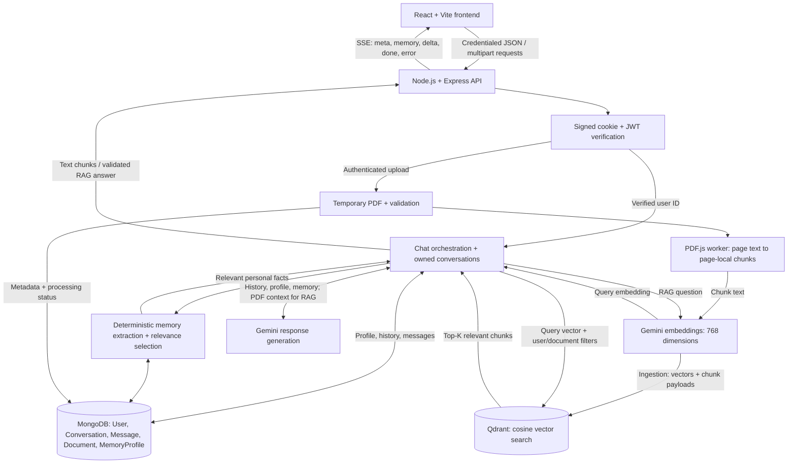

# 🤖 AI-Buddy

AI-Buddy is an AI-powered chatbot built using the MERN stack, Google Gemini API, Retrieval-Augmented Generation (RAG), and Qdrant. It supports real-time streaming responses, saved conversations, PDF-based question answering with page citations, and persistent user memory across conversations.

💡 Beyond basic chat, AI-Buddy combines recent conversation history and relevant personal memories from MongoDB with semantic PDF retrieval through Qdrant. It uses the authenticated user's account information to personalize responses while keeping conversation history, persistent memory, and document-based context separate.


## Architecture



Original PDFs are temporary processing inputs. MongoDB stores application records; Qdrant stores extracted chunk text, embeddings, and retrieval metadata. Indexed PDFs remain usable after the original file is removed.

## Technology stack

| Category | Implementation |
|---|---|
| Frontend | React 19, Vite 7 with React SWC, React Router 7, Material UI/Emotion, React Icons |
| Networking and rendering | Axios, Fetch/ReadableStream, React Markdown, remark-gfm, React Syntax Highlighter, React Hot Toast |
| Backend | Node.js, Express 5, ES modules, express-validator; nodemon for development |
| Application database | MongoDB with Mongoose 8 |
| AI responses | Gemini `gemini-2.5-flash` through `@google/generative-ai` |
| Embeddings | Gemini `gemini-embedding-001` through `@google/genai`; separate API key |
| Vector database | Qdrant REST client, 768-dimensional vectors, cosine similarity |
| Authentication | bcrypt, signed HTTP-only cookies, HS256 JWTs, cookie-parser, credentialed CORS |
| PDF processing | Multer disk uploads to OS temporary storage, `pdfjs-dist` in a Node worker thread |
| Deployment layout | Separate Vite static frontend and Express server; SPA fallback supplied in `frontend/public/_redirects` |

## Application flow

### Authentication and profile context

1. Registration accepts a name, email, and password. The backend validates input, lowercases new-account emails, hashes passwords with bcrypt cost 10, and creates the existing `User` record. Login checks email/password with bcrypt; existing mixed-case emails have a case-insensitive fallback.
2. Signup and login issue a seven-day JWT in the signed, HTTP-only `auth_token` cookie. The token is not returned in response JSON. Production cookies use `Secure` and `SameSite=None`; development uses `SameSite=Lax`.
3. `verifyToken` verifies the signed cookie and HS256 JWT, validates its identity fields, and places the verified user ID in `res.locals.jwtData`. Protected handlers derive ownership from this identity, not frontend-supplied user IDs.
4. Conversation ownership is checked before reading messages. Document and memory queries are owner-scoped; Qdrant operations also filter by user/document IDs.
5. `profile-context.service.js` reads only the account name from `User` using the verified ID. This enters the system prompt independently of memory and takes priority for account-name questions. Missing/unavailable names are not invented; the lookup does not copy profile data into memory.

Only name/email/password registration and email/password login are implemented. There is no OTP, OAuth, or password-reset flow. Signup establishes a session immediately; auth status and logout use the same cookie mechanism.

### Normal chat and real-time streaming

1. The composer sends the message to `ChatContext.jsx`. A conversation is created if needed; existing chats retain their conversation ID.
2. `frontend/src/helpers/api.js` makes a credentialed **POST** to `/api/v1/conversations/:id/messages/stream`. It consumes SSE through Fetch's `ReadableStream`, rather than `EventSource`.
3. The backend validates ownership and attachments, loads recent MongoDB messages before storing the current user message, then prepares relevant persistent memory and authenticated profile context.
4. `gemini.service.js` combines the base AI-Buddy instructions, memory rules/data, and profile rules/data into `systemInstruction`. Stored assistant roles become Gemini's `model` role; history remains chronological. The current message is sent separately.
5. `streamReply()` calls `model.startChat({ history })`, then **`chat.sendMessageStream(message, { signal })`**. It iterates `result.stream` and yields each non-empty `chunk.text()` as it arrives.
6. `conversation.controller.js` forwards those chunks as SSE `delta` frames. The frontend decodes bytes with `TextDecoder`, parses frames, appends text, and displays the response progressively. It does not wait for the complete ordinary-chat answer.
7. The backend saves the assistant message, updates conversation preview/count/title, and sends the final saved records. Stop/disconnection aborts upstream generation and retains available partial text as `stopped`. Mid-generation failures can retain an `error` answer; failed turns with no answer are excluded from future model context.

The response uses `text/event-stream`, `Cache-Control: no-cache, no-transform`, and `X-Accel-Buffering: no`. SSE frames contain a JSON `type` field:

| Type | Purpose |
|---|---|
| `meta` | Saved user message and conversation identifiers/data |
| `memory` | Memory availability, retrieval count, save status, and any safe warning; not saved fact values |
| `delta` | Incremental answer text |
| `done` | Persisted assistant message and updated conversation metadata |
| `error` | Safe error information and, when available, a persisted partial answer |
| `stopped` | A persisted partial answer when stopping can still be reported to the client |

The server emits a final `[DONE]` payload on completed/handled-error streams. The UI also supports Stop, regeneration, message deletion, conversation rename/delete, and loading older history. Non-streaming message endpoints and legacy `/api/v1/chat/*` routes remain available.

### PDF upload and processing

1. **Attach and upload.** `+ → Upload PDF` opens the picker and automatically uploads to `POST /api/v1/documents/upload`, using multipart field `file`. The UI accepts up to 10 attachments per question and queues uploads; new attachments replace inherited conversation attachments. Filename, size, progress, processing status, retry, and removal are shown. Submission is blocked until attached documents are confirmed `ready`.
2. **Validate and fingerprint.** After authentication, Multer accepts one file per request, enforces `.pdf` plus `application/pdf`, and limits size to 20 MiB by default. The server checks the `%PDF-` signature and computes a streamed SHA-256 hash. A server-generated filename is used in an OS temporary directory; client filenames are metadata only.
3. **Check services and duplicates.** The backend inspects Qdrant before processing. A partial unique MongoDB index on `(userId, contentHash)` supports byte-identical duplicate detection per owner. Ready/active records are reused without extraction or embeddings. Failed records can be retried with the same content/document ID; partial points are cleaned before reprocessing. There is no cross-user embedding cache.
4. **Track processing.** New uploads return `202` with metadata while an in-process job transitions `uploaded → processing → ready` or `failed`. The frontend polls exact attachment status IDs every five seconds while pending. The pool permits one job per user and two per backend process.
5. **Extract text.** `pdfjs-dist/legacy/build/pdf.mjs` runs in a worker thread, reads through PDF.js's file transport with 64 KiB range reads, and extracts text page by page while retaining page numbers. Unreadable PDFs and documents without meaningful extractable text are rejected. No OCR is performed.
6. **Remove original bytes.** Once extraction closes file handles, the service deletes the temporary original **before embedding/indexing**. Cleanup also runs in `finally` on success/failure; rejected uploads and reused duplicates have cleanup paths. Startup and five-minute sweeps attempt abandoned-temp cleanup and remove recognized legacy UUID-named originals from the old upload directory. New uploads are not permanently stored under `backend/uploads/pdfs/`, publicly served, or sent to cloud file storage.
7. **Chunk within pages.** `chunking.service.js` uses windows up to 2,800 characters, preferring sentence/newline boundaries after 2,000 characters, with approximately 400 characters of overlap adjusted to word boundaries. At roughly four characters/token, this is approximately 500–700 tokens with 100-token overlap. Empty/exact duplicate chunks are omitted. Chunks never cross pages: `pageStart` and `pageEnd` identify the same source page.
8. **Embed and index.** Ingestion submits two texts per embedding request. Vectors are checked for 768 finite values, nonzero magnitude, and normalized. Qdrant upserts use stable UUID-shaped IDs derived from document ID/chunk index. Payloads contain `text`, `userId`, `documentId`, `originalFilename`, `pageStart`, `pageEnd`, and `chunkIndex`; ownership fields have keyword payload indexes.
9. **Complete or fail explicitly.** MongoDB stores filename, hash, size/type, counts, ownership, timestamps, status, and safe errors—not PDF bytes or a permanent file path. `ready` is set only after all upserts finish. Partial indexing failures attempt owner/document-filtered point cleanup and mark failure. Document deletion removes Qdrant points before metadata; incomplete cleanup is reported.

Limits: 500 pages, two million extracted characters, 60 seconds for extraction, and 500 chunks. Processing has a 15-minute abort timer and a 20-minute reservation deadline. Expired jobs are marked failed on later owner-scoped list/status/delete activity, not automatically restarted. Cleanup failures are recorded/reported rather than treated as success.

### Qdrant search and PDF RAG

1. Attached document IDs activate RAG automatically and are persisted on conversations/user messages for follow-ups. Ordinary chat without document context follows the normal Gemini path. The API also supports explicit RAG without IDs, selecting up to 100 newest ready documents owned by that user.
2. The backend resolves ready, owned documents and validates selected IDs. It embeds the current question with the same `gemini-embedding-001` model and 768-dimensional normalization used for ingestion.
3. `retrieval.service.js` calls Qdrant's `client.query()` on `QDRANT_COLLECTION`. Mandatory payload filters match the verified `userId` and allowed `documentId` set. The collection uses a **single unnamed 768-dimensional vector with `Cosine` distance**.
4. Qdrant ranks semantic matches and returns **Top-K: 5 by default**, configurable from 1 to 10. Vector search finds conceptually related passages rather than requiring exact keyword matches. The service rechecks readiness after search and validates returned ownership, text, chunk indices, and page ranges. No score threshold or reranker is applied.
5. `rag.service.js` limits each retrieved chunk to 3,200 characters and combined PDF text to 12,000 characters. It also supplies relevant confirmed non-preference memories, the account profile, and up to 10 recent history messages within an 8,000-character budget, at most 2,000 characters per message. These are character limits, not tokenizer-enforced budgets.
6. The shared Gemini integration receives chronological history and a JSON question/source payload. Instructions require document claims to use PDF evidence, treat retrieved content as untrusted data, and distinguish insufficient information. Profile/memory/history may support conversational facts but cannot establish PDF contents. Only retrieved chunks—not entire PDFs or all indexed chunks—are supplied.
7. Gemini returns JSON statements with internal source references. The backend validates JSON shape, known source IDs, and statement/citation formatting, then maps cited document sources to actual page metadata. Answers display `[Page 2]` citations with duplicate pages removed per statement; source lists group filenames/pages. Missing metadata never creates a page number. Internal source/chunk identifiers remain available for processing but are hidden in the UI.
8. **RAG uses the same SSE endpoint, but buffers its answer until citation validation succeeds.** The backend then sends one validated `delta`, saves the assistant message/source metadata, and sends `done`. Ordinary chat remains incremental. Retrieval/provider/validation failures are surfaced; they do not silently switch to ungrounded chat.

Source validation checks references and structure, not the factual correctness of every claim. Internal profile/conversation references are not persisted as public PDF citations. Older saved source markers are translated into page labels using their saved metadata.

### Conversation history and persistent memory

| Context | Source | Role |
|---|---|---|
| Conversation history | `Message` records linked by conversation and owner | Recent user/assistant turns for follow-ups within that chat |
| Persistent personal memory | One owner-scoped `MemoryProfile` with structured entries | Relevant facts/preferences across conversations without requiring PDFs |
| Account profile | Existing authenticated `User` record | Account name, without requiring an introduction or memory |
| PDF RAG | Owned `Document` metadata plus Qdrant payloads/vectors | Document knowledge and page evidence |

**History:** the backend selects recent usable messages in descending ID order, then reverses them for Gemini. Normal chat defaults to 20 messages through `GEMINI_HISTORY_MESSAGES`; failed messages are excluded, while saved stopped/error partial answers can remain context. Normal history is message-count bounded, without a total token budget or summarization. Message listing returns chronological pages with an older-message `before` cursor or `skip` offset and `hasMore`; the UI loads 20 messages at a time and lists conversations in pages of 30.

**Extraction:** `memory-extraction.service.js` uses deterministic patterns, not another LLM call. Supported forms include:

- Identity/nickname: `My name is …`, short guarded `I am …` introductions, `You can call me …`; greetings such as `bro` and `hii` are stripped.
- Education: `I study at …`, `My college name is …`, degree and graduation-year declarations.
- Skills/projects: `My skills include …`, `I have experience with …`, `My project … uses …`, `I built …`, and explicit current-project declarations.
- Learning/goals: `I am learning …`, `I recently learned …`, `My current goal is …`, and supported interview-preparation/introduction requests.
- Preferences: concise/detailed answers, including/avoiding examples, step-by-step/bullet formatting, and English/Hindi/Hinglish in supported preference declarations.

Quoted text, questions, hypothetical/opt-out messages, and recognizable sensitive credentials or prompt-injection patterns are filtered. Extraction accepts at most 16 candidate facts per message. These guards are heuristic; unsupported phrasing may be missed.

**Storage:** entries carry category/key/value, source conversation/message references, timestamps, expiry, and confirmed/conflict state. Category/key matching and normalized values avoid duplicates. Explicit corrections and replaceable current-state facts update entries; uncertain conflicts retain alternatives. The profile holds up to 128 entries, with a unique user index and revision-based updates. Current learning topics/goals expire after 30 days; recently learned items after 90 days. Other supported stable facts remain until removed.

**Retrieval:** local scoring uses category keywords, question-word overlap, communication preferences, and recency. At most 12 memories fit within a 4,500-character serialized budget. Selected facts enter the prompt for normal chat, streaming, regeneration, and RAG. Memory-store failures produce safe warnings while generation can continue. Regeneration retrieves without re-extracting.

Users can view, delete, clear, or pause memory in **Manage Memory**. Pausing retains facts but prevents use/update. Clearing memory does not erase chat history or the account profile; deleting a conversation does not automatically erase saved memory. PDF chunks and assistant-generated resume statements are not automatically extracted into personal memory. Deleting a PDF does not erase previously saved answers.

### Gemini integrations

| Purpose | Implementation |
|---|---|
| Responses | `gemini-2.5-flash`, `@google/generative-ai`: `startChat()` with `sendMessageStream()` for normal streaming; `sendMessage()` for RAG, complete replies, and regeneration. Output limit 2,048; temperature 0.6. |
| Embeddings | `gemini-embedding-001`, `@google/genai`: `models.embedContent()` with `outputDimensionality: 768`, validation/normalization, and a separate key. Used for PDF chunks and retrieval questions. |

Conversation titles are local by default; `CHAT_TITLE_MODE=ai` enables a separate `generateContent()` title request with local fallback. Memory extraction/selection consumes no Gemini quota. Embeddings explicitly allow one request attempt; there is no application loop repeatedly retrying provider quota failures.

## Data storage and APIs

| MongoDB model | Responsibility |
|---|---|
| `User` | Name, unique email, bcrypt password hash; old embedded `chats` field retained for compatibility |
| `Conversation` | Owner, title, preview/count, timestamps, attachment IDs, legacy marker |
| `Message` | Owner/conversation, role/content, status, document references, source metadata, timestamps |
| `Document` | Owner, filename, content hash, size/type, counts, status/errors/deadlines, timestamps; no PDF binary |
| `MemoryProfile` | One profile/user, enabled flag, bounded entries, conflict alternatives, revision/deletion fencing |

Qdrant holds vectors and extracted text payloads, not original PDFs. MongoDB ownership is checked before retrieval; Qdrant search/deletion also use string-valued user/document filters. The unique document content-hash index supports concurrent duplicate detection.

All routes below are relative to `/api/v1`:

| Area | Routes |
|---|---|
| Authentication | `POST /user/signup`, `POST /user/login`, `GET /user/auth-status`, `GET /user/logout` |
| Conversations | `GET/POST/DELETE /conversations`, `GET/PATCH/DELETE /conversations/:id` |
| Messages | `GET/POST /conversations/:id/messages`, `POST /conversations/:id/messages/stream` |
| Message actions | `POST /conversations/:id/messages/:messageId/regenerate`, `DELETE /conversations/:id/messages/:messageId` |
| Documents | `POST /documents/upload`, `GET /documents`, `GET /documents/:id/status`, `DELETE /documents/:id` |
| Memory | `GET/DELETE /memories`, `DELETE /memories/:id`, `PATCH /memories/settings` |

## Environment variables

The backend loads `backend/.env` relative to its configuration module, independent of the working directory. Existing process values take precedence. Vite loads `frontend/.env`; `VITE_*` variables are public browser data. Never put provider/database credentials or signing secrets there.

| Backend variable | Purpose |
|---|---|
| `MONGO_URL` | MongoDB connection string |
| `JWT_SECRET` | JWT signing/verification |
| `COOKIE_SECRET` | Independent cookie-signing secret |
| `FRONTEND_URL` | Exact permitted browser origin for credentialed CORS |
| `GEMINI_API_KEY` | Generation and optional AI titles |
| `Gemini_API_KEY_for_embedding` | Separate embedding key; capitalization matters |
| `QDRANT_URL` | Cluster REST endpoint, not dashboard URL |
| `QDRANT_API_KEY` | Collection/vector/payload-index credential |
| `QDRANT_COLLECTION` | Collection name; no hardcoded fallback |
| `PORT` | Optional server port; default 3000 |
| `NODE_ENV` | Production cookie-security behavior |
| `GEMINI_HISTORY_MESSAGES` | Optional history count; default 20 |
| `CHAT_TITLE_MODE` | Optional title strategy: `local` default or `ai` |
| `PDF_MAX_SIZE_MB` | Optional positive upload limit; default 20, measured as MiB |
| `RAG_TOP_K` | Optional retrieval count; default 5, range 1–10 |

Frontend requires only `VITE_API_URL`: the backend base URL **including `/api/v1`**, used by Axios and SSE Fetch. Qdrant/embedding configuration is required for PDFs, not ordinary chat. Create the files yourself and replace these placeholders:

```dotenv
# backend/.env — placeholders only
MONGO_URL=<mongodb-connection-string>
JWT_SECRET=<jwt-signing-secret>
COOKIE_SECRET=<different-cookie-signing-secret>
FRONTEND_URL=<frontend-origin>
GEMINI_API_KEY=<generation-api-key>
Gemini_API_KEY_for_embedding=<embedding-api-key>
QDRANT_URL=<cluster-rest-endpoint>
QDRANT_API_KEY=<qdrant-api-key>
QDRANT_COLLECTION=<collection-name>
```

```dotenv
# frontend/.env — public configuration
VITE_API_URL=<backend-origin>/api/v1
```

For local defaults, the frontend origin is normally `http://localhost:5173` and backend base URL `http://localhost:3000/api/v1`. 

## Local setup

Prerequisites: Git, npm, compatible Node.js, MongoDB with permission to create schema indexes, Gemini credentials, and a Qdrant cluster. Installed PDF.js requires Node 22.13+; Node 22.17+ or a compatible newer release satisfies the current frontend/backend dependencies. PDF processing requires writable temporary disk space.

1. Clone:

   ```sh
   git clone https://github.com/ayushkhandelwal18/ai_buddy_chatbot
   cd ai_buddy_chatbot
   ```

2. Install frontend dependencies:

   ```sh
   cd frontend
   npm install
   ```

3. Install backend dependencies:

   ```sh
   cd ../backend
   npm install
   ```

4. Create `backend/.env` and `frontend/.env` as described above. Provision MongoDB and Qdrant; neither is started by the app. From `backend`, inspect/initialize the selected collection when needed:

   ```sh
   npm run qdrant:check
   npm run qdrant:init
   ```

   The check is read-only. Initialization creates only a missing collection and rejects incompatible existing vector configuration; it never deletes/recreates data. Neither command calls Gemini. Ingestion creates missing keyword indexes for `userId` and `documentId`, so the Qdrant credential needs those permissions. Collection setup does not run at startup.

5. Start the backend from `backend`:

   ```sh
   npm run dev
   ```

   The server listens after MongoDB connects. `npm start` runs the same entry point without nodemon.

6. In another terminal, start the frontend from the repository root:

   ```sh
   cd frontend
   npm run dev
   ```

   Open Vite's printed URL, register/login, and use chat or attach a PDF and wait for Ready before submitting.


## Project structure

```text
AI-Chat-Bot/
├── Readme.md
├── ARCHITECTURE_GUIDE.md
├── frontend/
│   ├── package.json / vite.config.js
│   ├── public/_redirects
│   └── src/
│       ├── App.jsx / main.jsx / theme.js
│       ├── Pages/                  # Landing, Login, Signup, Chat
│       ├── components/chat/        # Composer, messages, PDF/memory dialogs
│       ├── components/public/      # Shared public/auth components
│       ├── context/                # Auth, chat state, attachment lifecycle
│       └── helpers/                # API/SSE client, readiness, citations
└── backend/
    ├── package.json
    ├── scripts/                    # Qdrant inspection/init, legacy migration
    └── src/
        ├── index.js / app.js
        ├── config/                 # Environment, Gemini, Qdrant, upload limits
        ├── db/connection.js
        ├── models/                 # User, Conversation, Message, Document, MemoryProfile
        ├── routes/ / controllers/
        ├── middleware/             # Multipart PDF handling and errors
        ├── utils/                  # JWT, validation, safe service errors
        └── services/
            ├── gemini.service.js / profile-context.service.js
            ├── conversation.service.js
            ├── memory-extraction.service.js / memory-policy.service.js / memory.service.js
            ├── pdf-storage.service.js / pdf.service.js / pdf-extraction.worker.js
            ├── chunking.service.js / document-processing.service.js
            ├── embedding.service.js / document-index.service.js
            └── qdrant.service.js / retrieval.service.js / rag.service.js
```

## Current limitations

- Scanned/image-only PDFs need OCR, which is not implemented. There is no advanced image/diagram/table extraction or original-PDF viewer/download route.
- There is no hybrid search, BM25, reranking, or generic embedding cache.
- Memory is pattern-based and can miss unsupported statements. 

