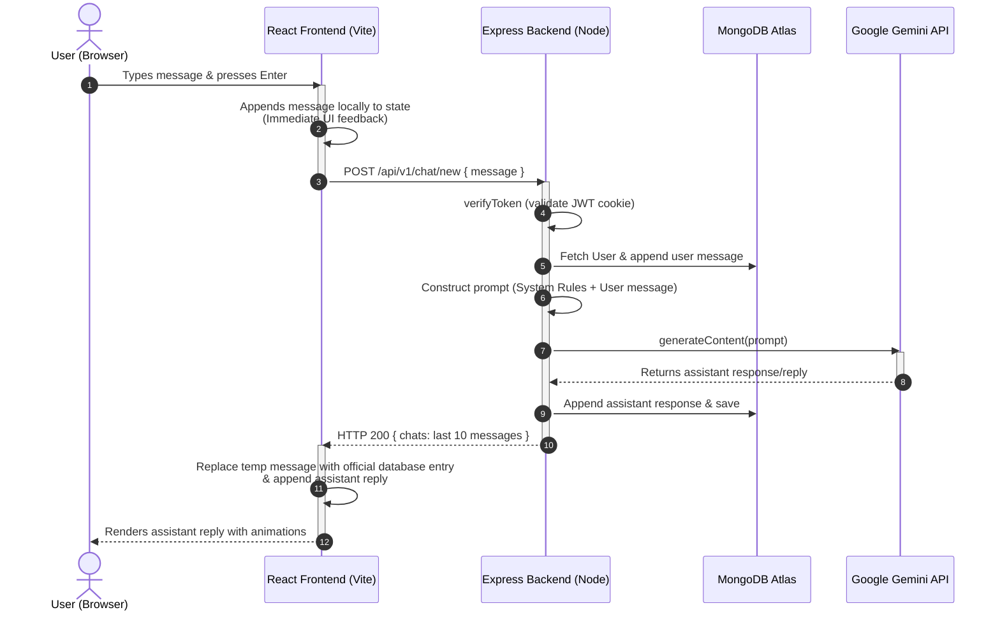

# 🤖 AI‑Buddy

A smart, reliable, and friendly AI chatbot built with the **MERN stack** + **Gemini API**. Handles all kinds of queries—general, coding, math, science, recipes, explanations, and more.

---

## ✨ Features

- Custom **user authentication & authorization**
- Data validation with **express-validator** middleware
- **MongoDB** storage for user chats
- **Paginated chat loading** (loads the last 10 messages by default, with a "Load Older Messages" button to load more in chunks)
- **JWT** tokens & **HTTP‑Only cookies** for secure auth
- **Auth-protected routes** with custom middleware
- Modern **React** frontend (Vite + JavaScript + SWC)
- Beautiful, responsive chat UI (**Material UI**)
- **React Hot Toast** for in-app feedback
- **React Icons** for iconography
- **React Syntax Highlighter** for code answers
- **React Type Animation** for typing effects

> **Bonus:** Clean, maintainable codebase, sensible folder structure, production‑ready configurations.

---

## 🧰 Tech Stack

**Frontend:**  
React · Vite · JavaScript · Material UI · React Hot Toast · React Icons · React Syntax Highlighter · React Type Animation

**Backend:**  
Node.js · Express.js · JavaScript (ES Modules) · express‑validator · cookie‑parser · JWT

**Database:**  
MongoDB Atlas (via Mongoose)

**AI:**  
Google Gemini API

---

## 🗂️ Project Structure

```bash
AI-Buddy/
├── backend/
│   ├── src/
│   │   ├── config/
│   │   ├── controllers/
│   │   ├── db/
│   │   ├── models/
│   │   ├── routes/
│   │   ├── utils/
│   │   └── index.js, app.js
│   └── package.json
│
├── frontend/
│   ├── src/
│   │   ├── assets/
│   │   ├── components/
│   │   ├── context/
│   │   ├── helpers/
│   │   ├── pages/
│   │   └── App.jsx, App.css, main.jsx, index.css
│   ├── index.html
│   └── package.json
│
└── README.md
```

---

## 🔐 Environment Variables

Create a `.env` file inside the **backend** folder:

```env
PORT=3000
MONGO_URL=your_mongodb_connection_string
JWT_SECRET=super_secret_key
COOKIE_SECRET=another_secret_if_used
GEMINI_API_KEY=your_gemini_api_key
FRONTEND_URL=http://localhost:5173
```

Create a `.env` file inside the **frontend** folder:

```env
VITE_API_URL=http://localhost:3000/api/v1
```

---

## ⚙️ Installation & Setup

```bash
# 1) Clone the repo
git clone https://github.com/ayushkhandelwal18/AI-Chat-Bot.git
cd AI-Chat-Bot

# 2) Backend setup
cd backend
npm install
npm start

# 3) Frontend setup
cd ../frontend
npm install
npm run dev
```

---

## 🔑 Authentication Flow (JWT + HTTP‑Only Cookies)

1. **Signup/Login:** Validates input with `express-validator`
2. On success: Issues a **JWT token** (set as HTTP‑Only cookie)
3. **Protected routes:** Check `req.cookies` → verify JWT → attach `req.user`
4. **Logout:** Clears cookie

---

## 🧪 API Endpoints 

**User Routes:**
- `POST   /api/v1/user/signup` &nbsp;–&nbsp; Register a new user
- `POST   /api/v1/user/login` &nbsp;–&nbsp; Login
- `GET    /api/v1/user/auth-status` &nbsp;–&nbsp; Check authentication status
- `GET    /api/v1/user/logout` &nbsp;–&nbsp; Logout and clear cookies

**Chat Routes:**
- `POST   /api/v1/chat/new` &nbsp;–&nbsp; Send a new chat message
- `GET    /api/v1/chat/all-chats` &nbsp;–&nbsp; Get all chats for logged-in user
- `DELETE /api/v1/chat/delete` &nbsp;–&nbsp; Delete all chats for logged-in user

---

## 🔄 Chat Communication Flow

Here is a step-by-step breakdown of how a message travels from the user's browser, through the backend, to the Gemini API, and back to the screen:



### 1. User Inputs Message (Frontend)
- The user types a message in the chat input in `Chat.jsx` and clicks Send (or presses Enter).
- **Local Update:** The frontend instantly adds the message to the local `chatMessages` state with the role `"user"` so the user sees their query immediately on the screen.
- **API Request:** The frontend calls `sendChatRequest(content)` which sends a `POST` request to `/chat/new` with the message content.

### 2. Request Handling & Verification (Backend)
- The request hits the backend at `/api/v1/chat/new`.
- **User Authentication:** The `verifyToken` middleware validates the user's session from their HTTP-Only cookie.
- **Database Fetch:** The `generateChatCompletion` controller loads the user's record from MongoDB.
- **Save User Message:** The backend pushes the user's message `{ role: "user", content: message }` to the user's `chats` array in MongoDB.

### 3. Gemini API Interaction (Backend & AI)
- The backend initializes the Gemini model (`gemini-2.5-flash`) via the Google AI SDK.
- It builds a prompt combining system rules (identity guidelines, behavior rules) and the user's latest query.
- Calls `generateContent(prompt)` to send the request to the Google Gemini API and awaits the generated reply.

### 4. Saving & Returning Response (Backend)
- Once the Gemini API replies, the backend pushes the assistant's response `{ role: "assistant", content: reply }` to the user's `chats` array.
- Saves the updated user document to the MongoDB database (`await user.save()`).
- **Paginated Response:** To keep performance optimized, the backend returns only the last 10 messages from the `chats` array to the frontend:
  ```json
  { "chats": [ ...last 10 messages... ] }
  ```

### 5. UI Render (Frontend)
- The frontend receives the response from the backend.
- **State Merging:** Instead of resetting the chat window, the frontend replaces the temporary local user message with the official database user message and appends the assistant's reply.
- **Display:** The list updates, and the user sees the formatted assistant reply on the page with typing animations and syntax highlighting.

---

## 🖥️ UI Highlights

- **MUI** components with responsive layout
- **React Hot Toast** for async feedback
- **Syntax highlighting** in code answers
- **Type animation** for branding and typing effects

---

## 🤝 Contributing

Pull requests are welcome!  
Feel free to open issues for suggestions or improvements.

---

## 🛠️ Customization

Change the prompt in `chat-controller.js` to personalize your chatbot’s behavior.

---
