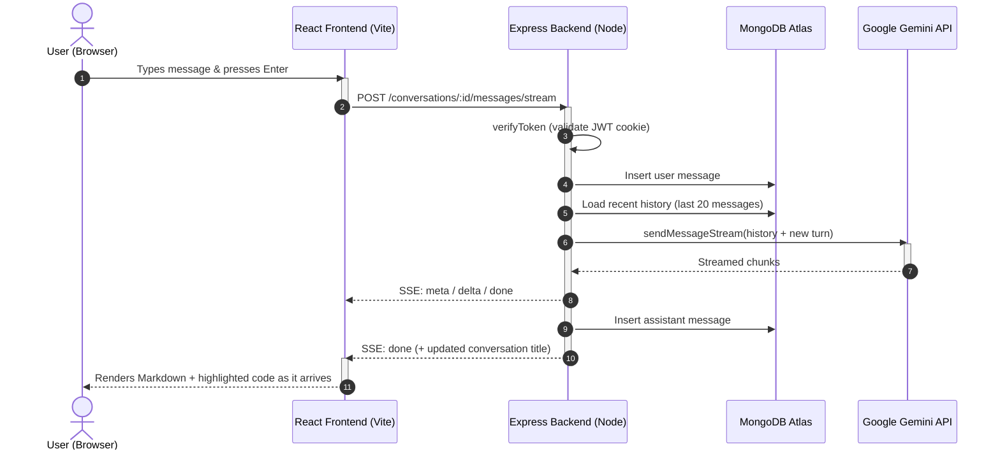

# 🤖 AI‑Buddy

A smart, reliable, and friendly AI chatbot built with the **MERN stack** + **Gemini API**. Handles all kinds of queries—general, coding, math, science, recipes, explanations, and more.

This release replaces the single‑chat screen with a **full chat workspace**: multiple conversations per user, a collapsible sidebar, streaming answers, Markdown + syntax highlighting, and a redesigned backend built around dedicated `conversations` / `messages` collections.

---

## ✨ Features

### Chat experience
- **Multi‑conversation** chats, one per user, each with its own URL (`/chat/:conversationId`) so links and refreshes work
- **Collapsible sidebar** with search, date‑grouped list, inline rename, per‑conversation delete and *delete all*
- **Auto‑titled conversations** derived from the first message
- **Streaming answers** over Server‑Sent Events, with a working **Stop** button (the partial answer is saved)
- **Markdown rendering** (GFM tables, lists, blockquotes) with **syntax‑highlighted code blocks** and *copy code* / *copy answer* / *regenerate* / *delete message* actions
- **Paginated history** — the last 20 messages load first, *Load older messages* fetches the rest
- **Welcome / empty state**, per‑message error state, and a typing indicator
- Fully **responsive**: the sidebar becomes a drawer on small screens

### Platform
- Custom **user authentication & authorization** (unchanged)
- Data validation with **express‑validator** middleware
- **MongoDB** storage split into `users`, `conversations` and `messages`
- **JWT** tokens & **HTTP‑Only cookies** for secure auth
- **Auth‑protected routes** with custom middleware
- Modern **React** frontend (Vite + JavaScript + SWC) with a custom dark **Material UI** theme
- **React Hot Toast** for in‑app feedback and **React Icons** for iconography

> **Bonus:** Clean, maintainable, modular codebase with sensible folder structure, production‑ready configurations, and a safe, idempotent data migration path.

---

## 🧰 Tech Stack

**Frontend:**
React · Vite · JavaScript · Material UI · React Router · react‑markdown · remark‑gfm · react‑syntax‑highlighter · React Hot Toast · React Icons

**Backend:**
Node.js · Express.js · JavaScript (ES Modules) · express‑validator · cookie‑parser · JWT

**Database:**
MongoDB Atlas (via Mongoose)

**AI:**
Google Gemini API (`gemini-2.5-flash`)

---

## 🗂️ Project Structure

```bash
AI-Buddy/
├── backend/
│   ├── scripts/
│   │   └── migrate-chats.js      # one‑off migration: user.chats → conversations + messages
│   ├── src/
│   │   ├── config/                # db + gemini clients
│   │   ├── controllers/
│   │   │   ├── auth-controller.js
│   │   │   ├── chat-controller.js      # legacy /chat/* wrappers
│   │   │   └── conversation.controller.js
│   │   ├── db/
│   │   ├── middleware/
│   │   │   ├── auth.middleware.js      # verifyToken
│   │   │   └── error.middleware.js
│   │   ├── models/
│   │   │   ├── user.model.js
│   │   │   ├── conversation.model.js
│   │   │   └── message.model.js
│   │   ├── routes/
│   │   ├── services/
│   │   │   ├── conversation.service.js  # all owner‑scoped data access
│   │   │   └── gemini.service.js        # system prompt, streaming, titles
│   │   ├── utils/
│   │   │   ├── api-error.js
│   │   │   └── validators.js
│   │   └── index.js, app.js
│   ├── .env.example
│   └── package.json
│
├── frontend/
│   ├── src/
│   │   ├── components/
│   │   │   ├── chat/              # Sidebar, TopBar, MessageList, MessageBubble,
│   │   │   │                      # Composer, CodeBlock, MarkdownContent, …
│   │   │   └── shared/
│   │   ├── context/
│   │   │   ├── AuthContent.jsx
│   │   │   └── ChatContext.jsx    # all chat state & actions
│   │   ├── helpers/
│   │   │   └── api.js             # REST helpers + SSE parser
│   │   ├── pages/
│   │   ├── theme.js
│   │   └── App.jsx, main.jsx, index.css
│   ├── .env.example
│   └── package.json
│
└── README.md
```

---

## 🔐 Environment Variables

Copy the example files and fill in your own values.

**backend/.env** (see `backend/.env.example`):

```env
PORT=3000
MONGO_URL=your_mongodb_connection_string
JWT_SECRET=super_secret_key
COOKIE_SECRET=another_secret_if_used
GEMINI_API_KEY=your_gemini_api_key
# optional
GEMINI_HISTORY_MESSAGES=20   # how many past messages are sent as context
CHAT_TITLE_MODE=local        # local | ai  (see "Gemini quota" below)
FRONTEND_URL=http://localhost:5173
```

**frontend/.env** (see `frontend/.env.example`):

```env
VITE_API_URL=http://localhost:3000/api/v1
```

> `VITE_API_URL` is **required** — it is used both by axios (`main.jsx`) and by the SSE streaming helper (`helpers/api.js`).

---

## ⚙️ Installation & Setup

```bash
# 1) Clone the repo
git clone https://github.com/ayushkhandelwal18/AI-Chat-Bot.git
cd AI-Chat-Bot

# 2) Backend setup
cd backend
npm install
cp .env.example .env        # then fill in your secrets
npm start

# 3) Frontend setup
cd ../frontend
npm install
cp .env.example .env        # then point VITE_API_URL at your backend
npm run dev
```

Useful scripts:

| Command | Where | What it does |
| --- | --- | --- |
| `npm start` | backend | starts the API on `PORT` (default 3000) |
| `npm run migrate` | backend | migrates legacy `user.chats` → `conversations` + `messages` |
| `npm run migrate -- --dry-run` | backend | reports what *would* be migrated, writes nothing |
| `npm run test:api` | backend | end‑to‑end API suite against a running server |
| `npm run dev` | frontend | Vite dev server on 5173 |
| `npm run build` | frontend | production build |
| `npm run lint` | frontend | ESLint |

---

## 🔑 Authentication Flow (JWT + HTTP‑Only Cookies)

Unchanged from the original app.

1. **Signup/Login:** Validates input with `express-validator`
2. On success: Issues a **JWT token** (set as HTTP‑Only cookie)
3. **Protected routes:** Check `req.cookies` → verify JWT → attach the user id to `res.locals.jwtData`
4. **Logout:** Clears cookie

Every conversation and message endpoint is owner‑scoped: the user id comes from the verified token, never from the request body, so one user can never read or modify another user's chats.

---

## 🧪 API Endpoints

**User Routes** (`/api/v1/user`):

- `POST   /user/signup` – Register a new user
- `POST   /user/login` – Login
- `GET    /user/auth-status` – Check authentication status
- `GET    /user/logout` – Logout and clear cookies

**Conversation Routes** (`/api/v1/conversations`) – all require a valid session:

| Method | Path | Purpose |
| --- | --- | --- |
| `GET` | `/conversations` | List the user's conversations (newest first, `?limit=&skip=`) |
| `POST` | `/conversations` | Create an empty conversation |
| `GET` | `/conversations/:id` | One conversation with its metadata |
| `PATCH` | `/conversations/:id` | Rename a conversation |
| `DELETE` | `/conversations/:id` | Delete a conversation and its messages |
| `DELETE` | `/conversations` | Delete **all** conversations of the user |
| `GET` | `/conversations/:id/messages` | Messages of a conversation (`?limit=&before=` for pagination) |
| `POST` | `/conversations/:id/messages` | Send a message, get a complete answer (non‑streaming) |
| `POST` | `/conversations/:id/messages/stream` | Send a message, stream the answer via **SSE** |
| `POST` | `/conversations/:id/messages/:messageId/regenerate` | Regenerate an assistant answer |
| `DELETE` | `/conversations/:id/messages/:messageId` | Delete a single message |

**Legacy Chat Routes** (`/api/v1/chat`) – kept for backwards compatibility, implemented as a thin wrapper over one per‑user "legacy" conversation:

- `POST   /chat/new` – Send a message, returns `{ chats: [...] }`
- `GET    /chat/all-chats` – All messages of the legacy conversation
- `DELETE /chat/delete` – Delete the legacy conversation

### Streaming protocol (SSE)

`POST /api/v1/conversations/:id/messages/stream` responds with `text/event-stream`. Every frame carries one JSON object whose `type` field names the event:

```
data: {"type":"meta",    "userMessage":{...},"conversation":{...}}
data: {"type":"delta",   "text":"partial text"}
data: {"type":"done",    "assistantMessage":{...},"conversation":{...}}
data: {"type":"stopped", "assistantMessage":{...,"status":"stopped"...}}
data: {"type":"error",   "message":"..."}
data: [DONE]
```

The frontend parses the frames manually with `fetch` + `ReadableStream` and aborts the request with an `AbortController` when the user presses **Stop**; the server then persists the partial answer with `status: "stopped"`.

### Error handling

| Situation | Response |
| --- | --- |
| Not signed in | `401` |
| Conversation/message not owned by the user | `404` (never `403`, so ids cannot be probed) |
| Invalid payload (empty message, bad id, …) | `422` with field errors |
| AI provider unreachable / out of quota | `503` with a readable message; the turn is stored as `failed` and excluded from the model context |

---

## 🔄 Chat Communication Flow



### Data model

```
User        { name, email, password, chats[] }   ← chats[] is kept only for the migration
Conversation{ userId, title, createdAt, updatedAt, lastMessageAt, messageCount, isLegacy }
Message     { conversationId, userId, role, content, status, createdAt, legacyId }
```

Both `conversations` and `messages` carry a `userId`, so every query is owner‑scoped and indexed:

- `conversations`: `{ userId: 1, lastMessageAt: -1, _id: -1 }`
- `messages`: `{ conversationId: 1, _id: -1 }`

Splitting the data out of the user document removes the 16 MB BSON limit that the old single‑document `chats` array ran into, and allows per‑conversation pagination and ordering.

`Message.status` records how a turn ended:

| status | meaning |
| --- | --- |
| `complete` | normal answer |
| `stopped` | the user pressed **Stop** — the partial answer is kept |
| `error` | the provider failed *after* part of the answer arrived |
| `failed` | the provider failed before anything arrived — the turn stays in the transcript but is **not** replayed to the model as context |

---

## 🗄️ Migrating existing chats

The old app stored every chat inside `user.chats`. The migration moves that history into the new collections **without losing anything**: message order, timestamps and content are preserved, and each message keeps a `legacyId` pointing back to its old id.

```bash
cd backend

# 1) Back up the current users collection (recommended)
mongodump --uri="$MONGO_URL" --collection=users --out=./backup

# 2) Preview — nothing is written
npm run migrate -- --dry-run

# 3) Run the migration
npm run migrate
```

The script is **idempotent**: running it twice does not duplicate anything. The old `user.chats` array is emptied only *after* the new documents have been written, so a failed run never loses data — and every migrated message keeps a `legacyId` pointing back to its original id.

---

## ⚠️ Gemini quota notes

The Gemini free tier allows only a **small number of `generateContent` requests per day** (20/day for `gemini-2.5-flash` at the time of writing). A single chat turn costs one request.

To avoid spending a second request on every new conversation, titles are derived **locally** from the first message by default:

| `CHAT_TITLE_MODE` | Behaviour |
| --- | --- |
| `local` (default) | Title is derived from the first user message in the backend — no extra API call, never fails |
| `ai` | Gemini writes a short title — nicer wording, but one extra API call per new conversation |

Set `CHAT_TITLE_MODE=ai` in `backend/.env` if you have quota to spare. Titles are always non‑blocking: if the model is unavailable the local title is used instead.

---

## 🖥️ UI Highlights

- Custom dark theme (Material UI `createTheme` in `frontend/src/theme.js`) with a cyan accent
- Markdown with GFM support and syntax‑highlighted code blocks with a *copy* button
- Sidebar search, date grouping, inline rename, delete / delete all
- Responsive drawer sidebar on mobile
- Loading, empty and error states for every asynchronous area

---

## 🤝 Contributing

Pull requests are welcome!
Feel free to open issues for suggestions or improvements.

---

## 🛠️ Customization

- **AI personality / rules:** edit `SYSTEM_INSTRUCTION` in `backend/src/services/gemini.service.js`
- **Colours, spacing, typography:** `frontend/src/theme.js` and `frontend/src/index.css`
- **Context window size:** `GEMINI_HISTORY_MESSAGES` in `backend/.env`
- **Title strategy:** `CHAT_TITLE_MODE` in `backend/.env`

---

## 🧭 Where to extend next

The backend is deliberately split into `routes → controllers → services → models`, and the frontend keeps all chat state in `ChatContext`, so the following can be added without touching the core:

- PDF / image attachments (upload + multimodal Gemini parts)
- Usage limits / quotas per user
- RAG with embeddings and a vector store
- Tool use via MCP or LangChain / LangGraph agents

---
